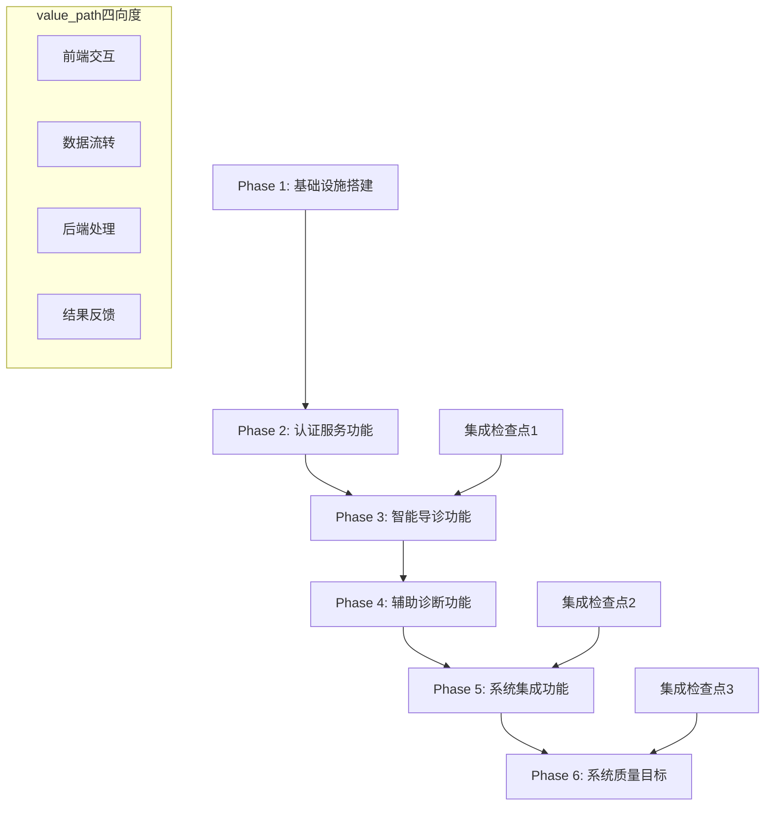

---
# SpecExecMasterPlan_L2.md

> **定位**: L2级别总控ProgressPlan文档
> **用途**: 总控ProgressPlan，链接所有SubPlan、GOAL、协调窗口与质量门禁
> **版本**: v1.0.0
> **生成时间**: 2025-10-30T09:34:44Z

## 项目元信息

- **项目名称**: ent_otorhinolaryngology_agent_system_v2
- **约束级别**: L2-BALANCED
- **协作模式**: C2-PARTICIPATE
- **技术栈**: Python+FastAPI+PostgreSQL+Redis+Docker+Kubernetes
- **架构模式**: 分层架构+微服务设计
- **执行版本**: v1.0.0

## 引用文档

- **Constraints**: [SpecExecMasterConstraints_L2.md](./SpecExecMasterConstraints_L2.md)
- **Lessons**: [SpecExecMasterLessons_L2.md](./SpecExecMasterLessons_L2.md)
- **Dashboard**: [SpecExecMasterDashboard_L2.md](./SpecExecMasterDashboard_L2.md)

## SubPlan索引表

| 序号 | SubPlan文件 | 类型 | 关联GOAL | 关联Phase | 预估Round | 协调窗口 | 风险等级 | 状态 |
|------|-------------|------|----------|-----------|-----------|----------|----------|------|
| 01 | SpecExecSubPlan_01_INFRASTRUCTURE_L2.md | 基础设施 | GOAL-1 | Phase 1 | 4-6 | 无 | 低 | ⬜ |
| 02 | SpecExecSubPlan_02_GOAL-AUTH-002_L2.md | GOAL | GOAL-2 | Phase 2 | 6-8 | 认证集成 | 中 | ⬜ |
| 03 | SpecExecSubPlan_03_GOAL-TRIAGE-003_L2.md | GOAL | GOAL-3 | Phase 3 | 8-10 | 导诊集成 | 高 | ⬜ |
| 04 | SpecExecSubPlan_04_GOAL-DIAGNOSIS-004_L2.md | GOAL | GOAL-4 | Phase 4 | 8-10 | 诊断集成 | 高 | ⬜ |
| 05 | SpecExecSubPlan_05_GOAL-INTEGRATION-005_L2.md | GOAL | GOAL-5 | Phase 5 | 6-8 | 系统集成 | 高 | ⬜ |
| 06 | SpecExecSubPlan_06_GOAL-QUALITY-006_L2.md | GOAL | GOAL-6 | Phase 6 | 6-8 | 最终集成 | 中 | ⬜ |

## Phase与value_path依赖图

### 集成门禁与风险缓冲

| 集成检查点 | 位置 | 验证内容 | 风险缓冲 | 质量门禁 |
|------------|------|----------|----------|----------|
| 集成检查点1 | Phase 2完成后 | 认证服务与基础设施集成 | 2-3天 | 认证功能100%通过 |
| 集成检查点2 | Phase 4完成后 | 核心AI功能集成 | 3-5天 | AI功能准确率≥85% |
| 集成检查点3 | Phase 5完成后 | 外部系统集成 | 3-5天 | 集成成功率≥99% |
| 最终集成 | Phase 6完成后 | 端到端系统验证 | 5-7天 | 所有质量指标达标 |

## GOAL覆盖表

| GOAL ID | GOAL名称 | source_us | related_sc | related_seq | assigned_subplan | status | KPI |
|---------|----------|-----------|------------|-------------|------------------|--------|-----|
| GOAL-0 | TDD环境准备目标 | US-TRIAGE-001 | SC-TRIAGE-001 | SEQ-TASK-001 | SubPlan_01 | ⬜ | 环境隔离100% |
| GOAL-1 | 基础设施搭建目标 | US-TRIAGE-001 | SC-TRIAGE-002 | SEQ-TASK-001 | SubPlan_01 | ⬜ | 环境就绪率100% |
| GOAL-2 | 认证服务功能目标 | US-TRIAGE-001 | SC-TRIAGE-003 | SEQ-TASK-001 | SubPlan_02 | ⬜ | 认证成功率≥99% |
| GOAL-3 | 智能导诊功能目标 | US-DIAGNOSIS-001 | SC-DIAGNOSIS-001 | SEQ-TASK-001 | SubPlan_03 | ⬜ | 导诊准确率≥95% |
| GOAL-4 | 辅助诊断功能目标 | US-DIAGNOSIS-001 | SC-DIAGNOSIS-002 | SEQ-TASK-001 | SubPlan_04 | ⬜ | 诊断准确率≥85% |
| GOAL-5 | 系统集成功能目标 | US-INTEGRATION-001 | - | SEQ-TASK-001 | SubPlan_05 | ⬜ | 集成成功率≥99% |
| GOAL-6 | 系统质量目标 | US-INTEGRATION-001 | - | SEQ-TASK-001 | SubPlan_06 | ⬜ | 性能达标率100% |

## 全局HITL检查点

### Phase边界协作检查
1. **Phase 1完成**: 基础设施就绪性验证
2. **Phase 2完成**: 认证服务集成验证
3. **Phase 3完成**: 智能导诊功能验证
4. **Phase 4完成**: 辅助诊断功能验证
5. **Phase 5完成**: 系统集成功能验证
6. **Phase 6完成**: 最终系统质量验证

### 决策选项矩阵
| 检查点 | ✅继续 | 🔄局部重构 | 🟡需求澄清 | ⏸️风险缓冲 |
|--------|--------|-------------|-------------|-----------|
| Phase 1 | 基础设施完整 | 环境配置调整 | 技术栈确认 | 延长基础设施时间 |
| Phase 2 | 认证功能完整 | 权限模型调整 | 安全需求确认 | 延长认证开发时间 |
| Phase 3 | 导诊功能完整 | 算法模型调整 | 业务规则确认 | 延长导诊开发时间 |
| Phase 4 | 诊断功能完整 | 推理引擎调整 | 医学规则确认 | 延长诊断开发时间 |
| Phase 5 | 集成功能完整 | 接口协议调整 | 集成需求确认 | 延长集成开发时间 |
| Phase 6 | 质量目标完整 | 性能优化调整 | 质量标准确认 | 延长质量优化时间 |

## 风险/恢复策略

### 技术风险
| 风险项 | 概率 | 影响 | 缓解策略 | 恢复方案 |
|--------|------|------|----------|----------|
| AI模型集成复杂 | 中 | 高 | 提前技术预研 | 降级到规则引擎 |
| 外部系统集成困难 | 高 | 高 | 早期接口对接 | 手动数据导入 |
| 性能不达标 | 中 | 中 | 持续性能测试 | 架构优化/硬件升级 |
| 安全合规问题 | 低 | 高 | 安全设计评审 | 安全加固方案 |

### 进度风险
| 风险项 | 概率 | 影响 | 缓解策略 | 恢复方案 |
|--------|------|------|----------|----------|
| 需求变更频繁 | 中 | 中 | 敏捷开发方法 | 优先级调整 |
| 技术难点延期 | 中 | 中 | 技术专家支持 | 功能降级 |
| 资源不足 | 低 | 高 | 资源预留计划 | 外部资源补充 |
| 集成问题 | 高 | 高 | 早期集成测试 | 集成方案调整 |

## Plan变更历史

| 版本 | 时间 | 变更内容 | 影响范围 | 变更原因 |
|------|------|----------|----------|----------|
| v1.0.0 | 2025-10-30 | 初始版本创建 | 全局 | 基于SPEC脚手架生成 |

## KPI指标

### 全局KPI
- **SubPlan完成率**: 0% (0/6)
- **Round完成率**: 0% (0/44)
- **GOAL达成率**: 0% (0/7)
- **质量门禁通过率**: 0%
- **风险关闭率**: 0%

### 质量指标
- **代码覆盖率目标**: ≥80%
- **集成通过率目标**: ≥95%
- **API响应时间目标**: ≤2秒
- **系统可用性目标**: ≥99.5%

### 进度指标
- **总体进度**: 0%
- **当前Phase**: Phase 1 (基础设施搭建)
- **当前SubPlan**: SubPlan_01 (基础设施)
- **预计完成时间**: 8-12周

## Dashboard引用占位

- **Dashboard状态**: [SpecExecMasterDashboard_L2.md](./SpecExecMasterDashboard_L2.md)
- **Lessons记录**: [SpecExecMasterLessons_L2.md](./SpecExecMasterLessons_L2.md)
- **SubPlan状态**: 见Dashboard SubPlan执行状态总览
- **Round进度**: 见Dashboard Round进度汇总

## 执行说明

### C3-ProducerConsumer合同
- **Producer**: 各SubPlan负责具体执行和产出
- **Consumer**: Dashboard负责验证SubPlan产出和质量门禁
- **Contract**: SubPlan必须按质量门禁标准交付，Dashboard验证通过后方可继续

### C2-PDCA循环
- **Plan**: 每个Round开始前制定详细计划
- **Do**: 按计划执行开发和测试
- **Check**: 验证质量门禁和KPI指标
- **Act**: 根据验证结果调整后续计划

### E1-EmergencyProtocol
- **STOP**: 遇到阻塞性问题时立即停止
- **Report**: 记录问题详情和影响范围
- **Rollback**: 必要时回滚到稳定状态
- **Fix**: 制定并执行修复方案
- **Verify**: 验证修复效果
- **Resume**: 恢复正常执行

---

**总控说明**: 本文档为ProgressPlan体系的总控文档，负责协调所有SubPlan的执行，确保项目按计划推进并达到质量目标。
