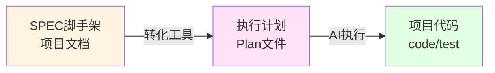
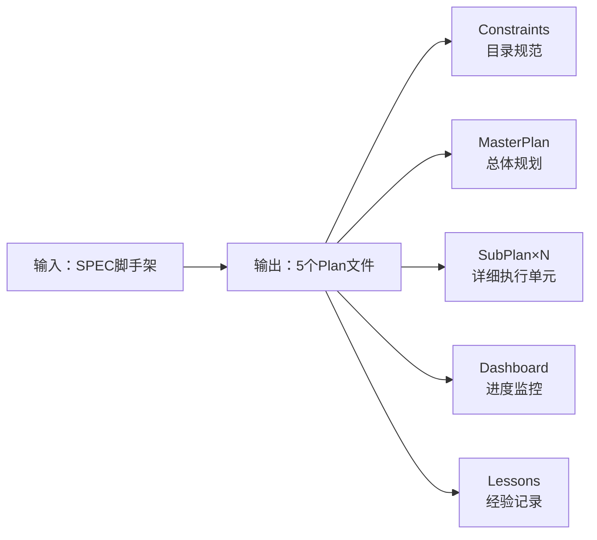
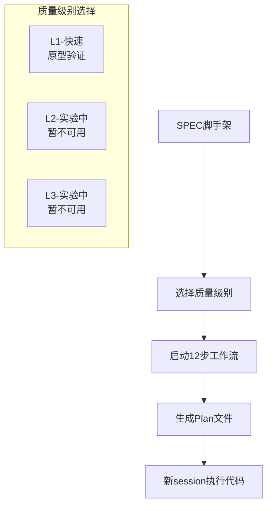
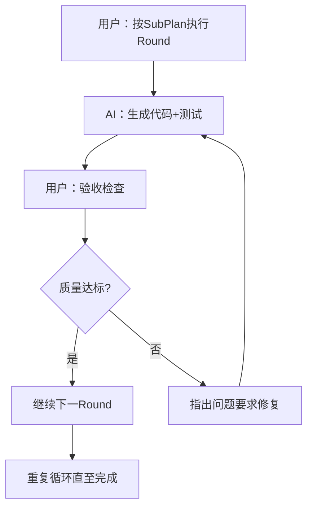

# SPEC到代码转换工具使用指南

将项目文档自动转换为可执行代码的AI工具集。

> ⚠️ 工具可用性：目前只有L1执行引擎稳定可用；L2与L3仍在实验调试阶段，暂不提供使用。

## 🎯 核心价值：SPEC转Plan转代码

借鉴SPEC框架的核心理念：



**这里的工具专门解决第2步**：将已有的SPEC脚手架文档转化为AI可执行的开发计划。

### 转化价值
- **从静态文档** → **动态执行计划**
- **从需求描述** → **具体任务序列** 
- **从设计思路** → **编码步骤**
- **从验收标准** → **测试清单**

## 🚀 快速开始

### Part A: 生产计划（第一个session）

**一句话启动**：
```
我有SPEC脚手架，要转换为可执行计划。

使用L[1/2/3]级别，开始12步工作流。

SPEC位置：[上传spec文件夹]
转换工具：[上传Build_Spec_Exec_Master_Plan_LX.md]

从Step 1开始。
```

**质量级别选择**：
- **L1**: 快速转化，适合原型和验证项目（40-70分钟）
- **L2**: 暂不可用（实验阶段，尚未调试完成）
- **L3**: 暂不可用（实验阶段，尚未调试完成）

**期望输出**：生成5个Plan文件


---

### Part B: 推动代码生产（第二个session）

**新session启动**：
```
按SpecExecSubPlan_01的Round 1执行：
- 生成对应代码
- 运行测试验证
- 检查覆盖率达标(L1≥80%, L2≥85%, L3≥90%)
- 更新进度到Dashboard
```

**执行节奏**：


**人机协作要点**：
- ✅ **用户把关质量** - 按验收标准检查代码
- ✅ **AI负责生成** - 根据Plan自动编写代码和测试
- ✅ **循环迭代** - 一个Round完成后继续下一个

---

## 📋 详细说明

### 转化工作流程



### 准备材料
- **SPEC脚手架文件夹** (包含4阶段文档)
- **转换引擎文件** 三选一：
  - `Build_Spec_Exec_Master_Plan_L1.md`
  - `Build_Spec_Exec_Master_Plan_L2.md`（实验阶段，暂不可用）
  - `Build_Spec_Exec_Master_Plan_L3.md`（实验阶段，暂不可用）

## ⚠️ 执行要点

### 标准配合流程
1. **AI执行当前步骤** → 分析、生成、验证
2. **AI报告完成状态** → 显示进度和结果  
3. **用户输入"继续"** → 推进到下一步
4. **重复12次** → 直到"🎉 全部完成"

### 关键注意事项
- ✅ 等AI确认每步完成再说"继续"
- ✅ 认真回答HITL决策问题
- ✅ 中途不要修改核心需求
- ❌ 不要跳步或要求并行执行

### HITL决策模板
- **文件冲突**："A.备份覆盖" / "B.保留现有" / "C.暂停Review"
- **技术栈确认**："确认" / "改为XXX" / "解释选择原因"
- **质量标准**："同意" / "提高到XX%" / "放宽到XX%"

## ✅ 验收成果

转换完成后检查以下5个文件：

| 文件类型 | 内容 | 行数 |
|---------|------|-----|
| **Constraints** | 目录结构规范、技术栈约定 | 80-120 |
| **MasterPlan** | 项目总规划、模块分解 | 150-250 |
| **SubPlan** | 详细执行单元(多个文件) | 400-800 |
| **Dashboard** | 进度监控、质量追踪 | 200-300 |
| **Lessons** | 经验记录、问题案例库 | 300-400 |

## 🔄 代码生成执行

### Round执行循环


## 💡 常见问题

| 问题 | 解决方案 |
|------|----------|
| 卡在某步骤 | 检查SPEC完整性 → 简化需求 → 选择更低级别 |
| Plan质量不满意 | 重新开始 → 提供更详细SPEC → 在HITL点明确要求 |
| 中途修改需求 | 尽量在Step 1-4修改 → 评估影响 → 必要时重启 |

## 🎯 核心价值

**工具价值**：文档→Plan→代码的标准化转换链路  
**用户价值**：业务判断、质量把关、风险控制、创新思考
