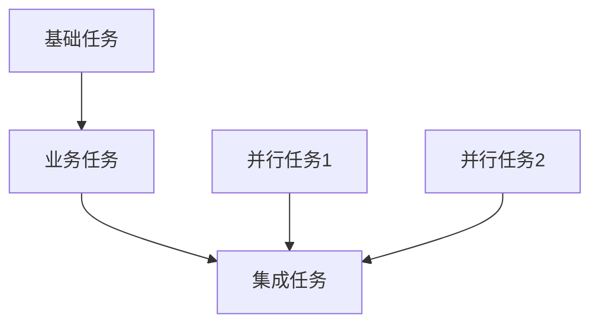
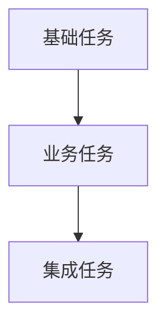

# 任务规划阶段约束原则 - L2-BALANCED

> **级别定位**: L2-BALANCED (标准流程级 - 平衡质量与效率)
> **🤝 哼将配对**: 与 [CRAFT_L2_TASK_PLANNING.md](../four_stage_crafting/CRAFT_L2_TASK_PLANNING.md) 配对协作
> **核心概念参考**: [CONSTRAINT_CORE_CONCEPTS.md](CONSTRAINT_CORE_CONCEPTS.md)

## 🔗 命名规范权威引用

> - 核心概念定义见 `../agentic_spec/SPEC_ARTIFACT_NAMING_CORE_CONCEPTS.md` (PREFIX, SN, Front Matter, 追溯链字段)
> - L2 级别执行要求见 `../agentic_spec/SPEC_ARTIFACT_NAMING_L2_AUTHORITY.md` (必填 artifacts, 严格模式, 验收标准)

## 🔗 AICodingAgent规范权威引用

> - **ACA宪法**: `../agentic_spec/SPEC_ACA_CORE_PRINCIPLES.md` - 不变量与契约定义 (I1-I4, C1-C3, PDCA)
> - **L2宪章**: `../agentic_spec/SPEC_ACA_L2_CHARTER.md` - L2质量标准 (6-10检查点, 通过率≥95%, 双层追溯)

---

## 🔥 TL;DR - 立即开始

> **目标**：掌握L2-BALANCED任务规划约束标准，平衡TDD策略质量与效率
> 
> **核心价值**：标准声明式目标制定，平衡质量与效率，为AI自主执行提供目标导向指导

### ⚡ LLM策略要点速查
#### 🚫 严禁行为
- 完成当前任务后绝不自动开始下一个任务（必须停止等待用户指示）
- 绝不在未读requirements/design/implementation三阶段文档情况下执行任务
- 绝不在阶段完成前省略tdd_task_tracking.md和tdd_strategy_order.md的创建
- 不过度简化或过度复杂化任务管理

#### ✅ 必须规划
- **上下文验证**：执行前必须确认已读requirements/design/implementation三文档
- **标准化目标制定**：设定团队协作所需的目标和验收标准，支持分工协作
- **标准里程碑**：标准里程碑体系，明确验收条件和责任人
- **中等容错控制**：计划变更需评估影响，平衡灵活性与控制
- **一次一任务**：完成当前任务后必须停止，等待用户指示
- **最终交付物**：阶段完成时必须创建6个核心文档([task_breakdown] + [task_sequence] + [blocker_anticipation] + [ai_context_specification] + [task_coordination_spec] + [acceptance_checkpoints])
- **团队协作支持**：任务分解支持团队并行开发，接口清晰

---

## 术语口径（中文 → English）
- 任务规划（Task Planning）
- 项目管理（Project Management）
- 里程碑管理（Milestone Management）
- 进度跟踪（Progress Tracking）
- 依赖分析（Dependency Analysis）
- 阻塞预判（Blocker Anticipation）
- 团队协作（Team Collaboration）
- TDD策略任务规划（TDD Strategy Task Planning）

---

## 🧪 TDD在任务规划阶段的L2定位

**核心原则**：⭐ TDD的标准策略任务规划阶段 - 完整执行规划准备

```
TDD在L2任务规划阶段的职责边界：
✅ 应该做：规划标准TDD策略任务和验证方法
✅ 应该做：制定中等粒度任务的策略步骤和验证标准
✅ 应该做：为后续TDD实施准备提供标准任务清单
✅ 应该做：基于requirements/design/implementation的全面验证规划
✅ 应该做：支持团队协作的任务分解和接口设计
❌ 不应做：修改测试计划（属于implementation阶段职责）
❌ 不应做：直接进行代码生产（应通过task_planning指导后续TDD策略）
```

**价值体现**：完成贯通流程的标准文档闭环：基于完整测试计划的TDD策略任务规划

---

## 🎯 L2约束检查重点

### 哼将产出验收标准

> **"哼哈二将"角色分离说明**：在本框架中，CRAFT负责实际内容生产（"哼将"），CONSTRAINT负责质量检查验收（"哈将"）。本文档作为"哈将"，专门验收CRAFT生产的内容质量。

**验收CRAFT生产的任务规划符合L2-BALANCED标准：**

- **标准规划验证**: 确保任务规划体现"平衡质量与效率"原则
- **中等粒度验证**: 检查任务颗粒度为0.5-2天完成，支持团队协作
- **标准里程碑验证**: 确保里程碑体系标准，验收条件明确
- **容错控制验证**: 验证计划变更需评估影响，平衡灵活性与控制
- **团队协作验证**: 检查任务分解支持团队并行开发，接口清晰
- **上下文验证**: 检查基于requirements/design/implementation三文档
- **交付物验证**: 检查包含tdd_task_tracking.md和tdd_strategy_order.md
- **输出完整性**: 验证任务规划文档覆盖核心任务类型，规划详实度适中
- **目标业务化验证**: 验证Goal标题使用业务术语，包含业务价值说明
- **验收标准分离验证**: 检查验收标准分为"业务视角"和"技术验证"两部分
- **技术术语密度验证**: 验证技术术语密度 ≤ 50%，目标层面业务化
- **L2团队协作验证**: 检查任务规划支持团队协作执行，目标清晰

---

## 📋 验收执行协议 ⭐ AI强制执行指南

> **目的**: Task-S6-3必须输出结构化验收报告，包含：验收对象清单、逐项检查结果（✅/❌+具体证据）、通过率统计、失败项详单、验收结论。
>
> **L2特征**: 验收项比L1更多（14项）、标准更严格，需检查团队协作、文档数量=6。

### 🔴 强制验收项（L2-BALANCED标准）

#### 1. 任务分解合理性验收
- 任务粒度0.5-2天，支持团队协作
- 任务描述完整可执行
- L2额外要求：支持团队并行开发

#### 2. 任务格式合规验收
- 十进制编号 + 复选框 + 四要素（任务目标、需求引用、测试要求、预期输出）

#### 3. 文档维度完整性验收 ⭐ 新增
- **L2核心维度标准**: 必须覆盖6个核心维度
  - 维度1: Task Breakdown（任务分解维度）- 必需
  - 维度2: Task Sequence（任务序列维度）- 必需
  - 维度3: Blocker Anticipation（阻塞预判维度）- 必需
  - 维度4: AI Context Specification（AI上下文规格维度）- 必需
  - 维度5: Task Coordination Spec（任务协调规格维度）- 必需（L2新增）
  - 维度6: Acceptance Checkpoints（验收检查点维度）- 必需（L2新增）
- **维度覆盖验收**: 6个核心维度必须覆盖
- **检查方法**:
  - 步骤1: 确认6个核心维度必须覆盖（每个维度至少有对应文档体现）
  - 步骤2: 确认CRAFT_L2_TASK_PLANNING.md体现维度驱动原则（维度是核心，文件数量是反映）
- **失败案例**:
  - "6个task_breakdown文件" → 缺少其他5个维度覆盖
  - "4个基础维度 + 2个Sequence" → 缺少Coordination/Checkpoints维度覆盖

#### 4. 依赖关系清晰验收
- 完整依赖关系分析，支持团队协作
- L2额外要求：依赖关系图清晰

#### 5. 优先级排序验收
- 标准里程碑体系，验收条件明确
- L2额外要求：责任人清晰

#### 6. 可执行性验收
- 任务目标明确，验收标准完整
- AI上下文规格完整
- L2额外要求：团队协作接口清晰

#### 7. 声明式目标验收
- Goal描述结果（不是步骤），避免过程式代码

#### 8. 团队协作标准验收 ⭐ L2特有
- 任务分解支持团队并行开发
- 接口清晰，支持分工协作
- 任务协调规格文档完整

#### 9. 容错控制验收
- 计划变更需评估影响
- 平衡灵活性与控制

#### 10. 节奏控制验收
- 遵循一次一任务原则

#### 11. 上下文验证
- 基于requirements/design/implementation三阶段文档

#### 12. 验收检查点验收 ⭐ L2特有
- 验收检查点文档存在且完整

#### 13. TDD环境准备GOAL验收（⭐ TDD特有需求）
- goal_breakdown.md中存在环境准备GOAL（团队共同讨论确定）
- 声明三个维度需求：测试/开发环境分离、端口配置、.gitignore配置（标准化团队共识）
- 验收标准团队可验证（任何成员可独立启动环境、端口配置标准化、.gitignore团队评审通过、提供配置文档）
- 在任务序列文档中排首位
- 在任务协调规格文档中定义环境配置的协调检查点
- 在验收检查点文档中定义环境就绪的验收标准

#### 14. GOAL测试资产包驱动验收 ⭐ L2核心特色
- GOAL继承FP基础：每个GOAL基于FP测试资产包分解，非凭空想象
- 双层追溯完整：source_us + related_sc/related_seq关联完整
- 测试资产关联：GOAL与FP四维度资产明确关联
- 验收标准测试驱动：GOAL验收基于SC的Given-When-Then定义

---

### 📊 强制验收报告格式

```markdown
## 📋 CONSTRAINT验收报告 - L2 Task Planning - 第{N}轮

**验收标准**: CONSTRAINT_L2_TASK_PLANNING.md
**验收对象**: spec/task_planning/ 目录（X个文档，共Y行）

### 验收项结果

1. [✅/❌] 任务分解合理性验收
   - 检查结果: [具体证据]

2. [✅/❌] 任务格式合规验收
   - 检查结果: [具体证据]

3. [✅/❌] 文档维度完整性验收 ⭐
   - 检查结果: [具体证据]
   - 核心维度验收: Breakdown [✅/❌] + Sequence [✅/❌] + Blocker [✅/❌] + AIContext [✅/❌] + Coordination [✅/❌] + Checkpoints [✅/❌]
   - 失败示例: "6个task_breakdown文件，缺少其他5个维度"

11. [✅/❌] 上下文验证
   - 检查结果: [具体证据]

12. [✅/❌] 验收检查点验收 ⭐ L2特有
   - 检查结果: [具体证据]

13. [✅/❌] TDD环境准备GOAL验收 ⭐
   - 检查结果: [具体证据]
   - 环境GOAL存在性: [✅/❌] goal_breakdown.md中包含环境准备GOAL（团队讨论确定）
   - 三维度声明: [✅/❌] 测试/开发分离 + 端口配置 + .gitignore（标准化团队共识）
   - 验收标准团队可验证: [✅/❌] 成员可独立启动/端口标准化/.gitignore评审/配置文档
   - 执行顺序: [✅/❌] 任务序列文档中环境GOAL排首位
   - 协调检查点: [✅/❌] 任务协调规格文档中定义环境配置协调
   - 验收检查点: [✅/❌] 验收检查点文档中定义环境就绪验收

14. [✅/❌] GOAL测试资产包驱动验收 ⭐ L2核心特色
   - 检查结果: [具体证据]
   - GOAL继承FP基础: [✅/❌] 每个GOAL基于FP测试资产包分解，非凭空想象
   - 双层追溯完整: [✅/❌] source_us + related_sc/related_seq关联完整
   - 测试资产关联: [✅/❌] GOAL与FP四维度资产明确关联
   - 验收标准测试驱动: [✅/❌] GOAL验收基于SC的Given-When-Then定义

### 通过率统计
- 通过项: X/14
- **通过率**: Z%

### 失败项详单（如有）
- 验收项N: 失败原因 + 修复建议

### 验收结论
[✅ 通过率≥95%，继续Task-S6-4] / [❌ 通过率<95%，触发Human-in-the-loop]
```

**关键要求**:
- 每个验收项必须有明确判定（✅/❌）+ 具体证据
- L2特殊要求：团队协作标准必须验收、文档数量必须=6、任务粒度0.5-2天、环境准备GOAL必须包含团队协调和验收检查点、GOAL测试资产包驱动验收
- **通过率标准**: ≥95%通过，继续Task-S6-4；<95%触发Human-in-the-loop

---

## 📋 L2质量门禁标准

### ✅ 门1 · 就绪门 [G1-READY|LM2-FLEX]
按权威文件 `CONSTRAINT_CORE_CONCEPTS.md` 中 LM2-FLEX 原则逐条自检：
- [ ] Slice‑first + light layering（切片优先+轻分层）：功能切片基础上适度分层任务规划
- [ ] Acceptance‑to‑contract（验收到契约）：由需求验收反推任务验证设计
- [ ] 覆盖主流程 + 关键替代路径：任务规划覆盖主要业务流程
- [ ] NFR护栏：为关键非功能需求设计任务方案
- [ ] 模板与片段复用：任务规划/验证方法保持一致性

### 📋 门2 · 质量门 [G2-QUAL]
L2核心质量断言（14项标准检查）：
- [ ] **规划完整性**: 覆盖主要任务类型，任务规划/依赖分析/验证方法完整
- [ ] **任务颗粒度合理性**: 任务颗粒度适中(0.5-2天)，任务分解平衡
- [ ] **任务连贯性**: 任务序列逻辑连贯，支持增量构建和持续验证
- [ ] **可操作性**: 任务描述具体可执行，团队成员无需额外澄清即可理解
- [ ] **团队协作性**: 任务分解支持团队并行开发，接口清晰
- [ ] **阻塞控制性**: 阻塞预判策略明确，平衡进度与质量
- [ ] **边界合规性**: 无代码生产内容，保持任务规划职责边界
- [ ] **L2平衡性**: 任务规划覆盖5-7个核心维度类型，规划详实度与执行效率平衡适中
- [ ] **GOAL清单完整性**: `goal_breakdown.md` 存在且每个 GOAL front matter 含 `id/sn/status/source_us/related_sc/related_seq/context_refs`，并与 FP/SC/SEQ 追溯一致
- [ ] **GOAL引用闭环**: 所有有效的 `SC` 与 `SEQ` 至少出现在一个 GOAL 的 `related_sc` / `related_seq` 字段中，确保执行产物无孤立节点
- [ ] **受众适配性**: Goal用业务语言，执行细节可用技术语言
- [ ] **技术术语密度**: 技术术语密度 ≤ 50%
- [ ] **目标业务化**: Goal标题包含业务价值说明
- [ ] **验收标准分离**: 分为"业务视角"和"技术验证"
- [ ] **任务序列业务化**: 任务序列标题业务友好，包含业务目标/价值
- [ ] **L2团队执行**: 任务规划支持团队协作执行
- [ ] **🎯 L2命名格式验收**: 验收SEQ格式符合L2级别规范要求
  - [ ] **SEQ格式验收**: Task Sequence包含Front Matter (`id: SEQ-<SN>-NNN` + `sn: <SN>` + `status` + `related_fp: [FP-<SN>-XXX]`)
  - [ ] **追溯链验收**: SEQ通过related_fp关联到FP，通过related_sc关联到SC，体现任务组织网络
  - [ ] **ID格式验收**: 所有ID符合`<PREFIX>-<SN>-NNN`格式，SN不可省略
  - [ ] **阶段边界验收**: TASK_PLANNING阶段SEQ组织FP和SC，体现任务执行序列和并行管理
  - [ ] **任务序列验收**: SEQ包含任务执行序列、并行任务组织、依赖关系管理三个核心维度
- [ ] **🎯 TDD环境准备GOAL验收**:
  - [ ] goal_breakdown.md中存在环境准备GOAL（包含Front Matter: id/sn/source_us，团队共同讨论确定）
  - [ ] 声明三个维度需求：测试/开发环境分离、端口配置、.gitignore配置（标准化团队共识）
  - [ ] 验收标准团队可验证（任何成员可独立启动环境、端口配置标准化、.gitignore团队评审通过、提供配置文档）
  - [ ] 任务序列文档中环境GOAL排首位，确保优先执行
  - [ ] 任务协调规格文档中定义环境配置的协调检查点（团队同步机制）
  - [ ] 验收检查点文档中定义环境就绪的验收标准（多级验收）
- [ ] **⭐ GOAL测试资产包驱动验收** (L2核心特色): 验收GOAL基于FP测试资产包分解和双层追溯完整性
  - [ ] **GOAL继承FP基础**: 每个GOAL基于FP测试资产包分解，非凭空想象，有明确source_us指向
  - [ ] **双层追溯完整**: source_us指向明确，related_sc/related_seq关联完整，体现L2组织网络
  - [ ] **测试资产关联**: GOAL与FP四维度资产(场景层/套件层/数据层/环境层)明确关联
  - [ ] **验收标准测试驱动**: GOAL验收基于SC的Given-When-Then定义，测试驱动分解
  - [ ] **团队协作标准**: GOAL分解支持团队协作，验收标准团队可理解和验证
  - [ ] **端到端传递验证**: GOAL基于测试资产包传递，支持任务规划与实施阶段无缝对接
- [ ] **📋 LLM质量控制执行验证**: 验收CRAFT是否正确执行质量控制指令
  - [ ] **文件范围合规性**: 确认质量控制仅应用于spec/目录下非_前缀的MD文件（排除_开头的目录和文件）
  - [ ] **长度控制执行验证**: 内容是否按[L1:400-500行|L2:500-600行|L3:600-800行]限制生产，超出是否提供拆分建议
  - [ ] **补丁保护执行验证**: 修改后是否进行了[系统性|逻辑性|一致性]完整性检查，保护既有内容质量
  - [ ] **质量预防执行验证**: 是否执行了信息密度监控、结构清晰保持、术语统一验证等预防性措施
  - [ ] **阶段特异执行验证**: 是否完成了该阶段的特殊质量要求检查[需求逻辑链|架构连贯|TDD流程|任务分解]
  - [ ] **人机协作触发验证**: 发现问题时是否正确触发"立即停止→Human-in-the-loop→建议审查整理修复"机制
- [ ] **批准确认性**: 收到用户明确正面回应

---

## 📁 文件组织验收标准

### 目录结构检查（spec/task_planning/）
- **位置验收**: 默认`spec/task_planning/`或等效目录
- **GOAL清单**: 必须包含 `goal_breakdown.md`（集中维护 GOAL front matter，其他文档仅引用 GOAL ID；占位字段需在生成 SEQ/CTX 后补齐）
- **主线类目**: 任务跟踪如`[任务跟踪文件名].md`，策略规划如`[策略规划文件名].md`
- **必要分类**: 核心任务如`[核心任务文件名].md`，集成任务如`[集成任务文件名].md`
- **技术文档**: 阻塞预判如`[阻塞预判文件名].md`，团队协作如`[团队协作文件名].md`
- **交付物**: tdd_task_tracking.md在根目录，tdd_strategy_order.md在task_planning目录
- **命名规范**: 文件名采用lower_snake_case + `.md`
- **内容边界**: 严禁出现代码生产/具体TDD执行等非规划产物

---

## 🎯 边界约束原则

### ❌ 严禁行为
- **无上下文规划**: 绝不允许在没有前三阶段文档的情况下开始任务规划
- **超范围规划**: 包含非任务规划范围的内容，如实际代码生产
- **代码生产**: 不进行任何实际代码生产，专注任务规划

### ✅ 专注职责
- **标准任务规划**: 基于前三阶段的完整任务策略规划，支持团队协作
- **标准项目管理**: 中等粒度任务分解，标准进度跟踪体系
- **TDD策略准备**: 为红绿重构循环实施提供完整指导

---

## 🔧 标准任务规划指导

### L2任务粒度原则
- **中等粒度任务**: 0.5-2天完成，支持团队并行开发
- **标准里程碑**: 标准里程碑体系，明确验收条件和责任人
- **全面依赖**: 完整依赖关系分析，支持团队协作

### 标准项目管理要求
- **标准跟踪**: 标准项目管理工具，任务状态+阻塞+依赖跟踪
- **中等容错**: 计划变更需评估影响，平衡灵活性与控制
- **团队协作**: 任务分解支持团队并行开发，接口清晰

### 依赖关系图示例


---

## 🔒 质量门禁原则

### 📋 审批流程要求
```
任务规划完成后的强制流程：
1. 创建task_planning/目录结构，包含标准的任务规划体系
2. 基于前三阶段完成全面任务分解和策略规划
3. 创建强制交付物：tdd_task_tracking.md(根目录) + tdd_strategy_order.md(task_planning目录)
4. 确保交付物完整，包含必要的跟踪和策略文档
5. 如用户要求修改，必须调整后重新规划
```

### 🔄 反馈-修订循环机制
- **标准流程控制**: 遵循标准任务规划流程，平衡深度与效率
- **持续修订**: 必须根据用户反馈持续完善规划文档
- **完整性控制**: 确保任务规划文档结构完整，内容覆盖全面

---

## 📤 输出验收标准

### L2交付物验收
- **结构验收**: 标准`task_planning/`目录结构，覆盖任务分解、任务序列、阻塞预判、AI上下文规格、任务协调规格、验收检查点六个核心维度，支持功能模块分类和团队协作
- **强制交付物**: tdd_task_tracking.md在根目录，tdd_strategy_order.md在task_planning目录
- **内容验收**: 300-450行范围，平衡完整性与可读性
- **对接验收**: 确保输出能无缝成为TDD实施准备的标准输入
- **质量验收**: 标准规范，平衡效率和任务质量

### 质量标准验收
任务规划文档结构清晰，任务描述具体可执行，依赖关系明确

### 智能选择策略验收
根据项目类型进行任务规划选择：
- Web应用：标准三层任务分解 + RESTful API任务
- 移动应用：标准UI任务 + 数据同步任务
- 微服务：服务级任务分解 + 集成任务

---

## 🚨 L2常见违规行为

### ❌ 边界违规
- 在规划中生产实际代码或TDD执行
- 自动推进到下一个任务而不停止
- 跳过前三阶段文档直接开始规划

### ❌ 格式违规
- 缺少完整任务规划体系中的关键部分
- 任务分解不够详细或缺乏标准规范格式
- 依赖关系分析不充分或过于简化

### ❌ 质量违规
- 任务规划缺乏充分的团队协作考虑
- 不考虑与TDD实施准备阶段的标准对接
- 任务复杂度过高或过低，不符合L2平衡特征

**修正策略**: 回到L2标准原则，重新执行标准流程，确保标准依赖关系和质量平衡。

---

## 📄 L2格式模板详解

### 🔥 L2-BALANCED格式模板
```markdown
# TDD任务规划（L2平衡版）

## TDD策略概述
[完整TDD策略规划说明]

## 任务状态跟踪矩阵
| 任务类别 | 具体任务 | 状态 | 开始时间 | 完成时间 | TDD策略要点 | 验证标准 |
|----------|----------|------|----------|----------|-------------|----------|
| [功能域] | [具体任务] | 待开始 | - | - | [TDD策略] | [验证方法] |

## 策略规划依赖分析
### 依赖关系图


### 阻塞控制策略
- **高阻塞任务**: [识别和优先处理]
- **并行策略**: [可并行任务组划分]

## 验证跟踪规划
- **任务级验证**: [每个任务的验证方法]
- **需求回溯**: [需求符合性验证]

## 强制交付物说明
- tdd_task_tracking.md: 项目根目录TDD实施进度总跟踪
- tdd_strategy_order.md: task_planning目录TDD策略顺序规划
```

### 📊 标准结构要求
- **策略部分**：完整TDD策略任务规划概述和目标
- **跟踪部分**：标准任务跟踪矩阵 + 状态管理
- **分析部分**：依赖关系图 + 阻塞控制 + 并行策略
- **验证部分**：多层验证规划，为TDD做充分准备

---

## 📄 L2格式模板详解

### 🔥 L2-BALANCED格式模板

**🎯 Task Sequence 验收示例** (对齐CRAFT格式):
```yaml
---
id: SEQ-AUTH-050
sn: AUTH
status: active
related_fp: [FP-AUTH-025, FP-AUTH-026]
related_sc: [SC-AUTH-030, SC-AUTH-031]
---

# SEQ-AUTH-050 用户认证模块任务序列

## 任务执行序列
**执行阶段1**: FP-AUTH-025 用户登录验证功能点 → SC-AUTH-030 登录成功场景
**执行阶段2**: FP-AUTH-026 密码重置功能点 → SC-AUTH-031 密码重置场景
**执行阶段3**: 集成测试与端到端验证

## 并行任务组织
**并行窗口1**: FP-AUTH-025和FP-AUTH-026可并行开发（无直接依赖）
**同步点1**: 两个功能点完成后进行认证模块集成
**并行窗口2**: SC-AUTH-030和SC-AUTH-031可并行测试

## 依赖关系管理
**前置依赖**: 认证数据模型确立，基础权限框架就绪
**后续依赖**: 为权限管理模块提供认证基础，为用户管理模块提供身份验证
```

**📋 验收标准清单**:
- [ ] Front Matter完整（id + sn + status + related_fp + related_sc字段）
- [ ] ID格式正确（SEQ-AUTH-050，格式: SEQ-<SN>-NNN）  
- [ ] 追溯链正确（SEQ通过related_fp关联到FP，通过related_sc关联到SC）
- [ ] 任务序列完整（任务执行序列 + 并行任务组织 + 依赖关系管理）
- [ ] 🎯 **组织网络体现**（SEQ作为任务组织中心，关联多个FP和SC，体现L2组织网结构）
- [ ] 阶段边界正确（TASK_PLANNING阶段SEQ组织任务执行序列和并行管理）
- [ ] 业务语言与技术术语平衡（≤50%技术术语密度）

---

*"L2约束以平衡任务规划理念为核心，通过标准化检查和适度质量控制，确保为TDD实施准备提供完整标准策略指导。"*
