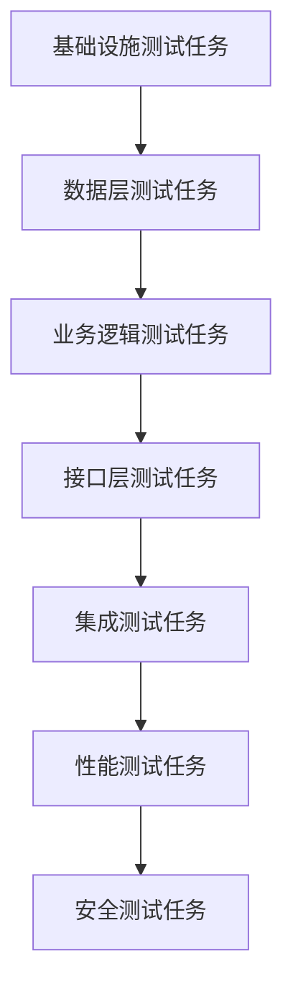

# 实施严格控制约束原则 - L3-RIGOROUS

> **级别定位**: L3-RIGOROUS (严格控制级 - 质量优于速度)  
> **🤝 哼将配对**: 与 [CRAFT_L3_IMPLEMENTATION.md](../four_stage_crafting/CRAFT_L3_IMPLEMENTATION.md) 配对协作
> **核心概念参考**: [CONSTRAINT_CORE_CONCEPTS.md](CONSTRAINT_CORE_CONCEPTS.md)

## 🔗 命名规范权威引用

> - 核心概念定义见 `../agentic_spec/SPEC_ARTIFACT_NAMING_CORE_CONCEPTS.md` (PREFIX, SN, Front Matter, 追溯链字段)
> - L3 级别执行要求见 `../agentic_spec/SPEC_ARTIFACT_NAMING_L3_AUTHORITY.md` (必填 artifacts, 严格模式, 验收标准)

## 🔗 AICodingAgent规范权威引用

> - **ACA宪法**: `../agentic_spec/SPEC_ACA_CORE_PRINCIPLES.md` - 不变量与契约定义 (I1-I4, C1-C3, PDCA)
> - **L3宪章**: `../agentic_spec/SPEC_ACA_L3_CHARTER.md` - L3质量标准 (10-15检查点, 通过率≥95%, 三层追溯)

---

## 🔥 TL;DR - 立即开始

> **目标**：掌握L3-RIGOROUS实施约束标准，严格TDD质量控制
> 
> **🎯 协作模式路径**：C3-LEAD用户选择L3时执行
> 
> **核心价值**：严格TDD粒度决策+项目规划，质量优于速度，支持审计，为任务规划提供明确战略指导

### ⚡ LLM策略要点速查
#### 🚫 严禁行为
- 不实际执行TDD（专注于策略制定）
- 不包含部署、培训、营销等非编码任务
- 不出现悬空的孤立任务
- 不简化严格测试要求，避免跳过形式化验证

#### ✅ 必须规划
- 基于design/交付物进行TDD策略转换
- **TDD粒度决策**：确定unit/integration/e2e测试的分配策略和边界划分，支持完整追溯
- **严格TDD覆盖**：高覆盖率要求(90%+)，完整边界+异常用例覆盖
- **严格Red-Green-Refactor循环**：持续重构保证代码质量，预防性重构
- **项目实施规划**：将TDD战略转化为可执行的项目实施计划和里程碑，支持审计追溯
- **低容错测试债务**：零测试债务，完整追溯，支持审计
- 强制格式：十进制编号+复选框+四要素(任务目标、需求引用、测试要求、预期输出)
- 详尽测试策略：完整测试金字塔(单元+集成+端到端+性能+安全测试)
- **形式化流程**：完整TDD决策记录，支持第三方审计
- 标准话术："实施策略看起来可以吗？如果可以，我们可以继续制定任务规划。"

---

## 术语口径（中文 → English）
- 测试驱动开发（Test-Driven Development, TDD）
- 红绿重构循环（Red-Green-Refactor Cycle）
- 测试金字塔（Test Pyramid）
- 单元测试（Unit Testing）
- 集成测试（Integration Testing）
- 端到端测试（End-to-End Testing）
- 性能测试（Performance Testing）
- 安全测试（Security Testing）
- 技术债务零容忍（Zero Technical Debt Tolerance）
- 代码质量保证（Code Quality Assurance）
- 测试策略决策记录（Test Strategy Decision Records）
- 持续重构（Continuous Refactoring）

---

## 🧪 TDD在实施规划阶段的L3定位

**核心原则**：⭐ TDD的严格主场 - 完整严格测试驱动策略制定

```
TDD在L3实施规划阶段的职责边界：
✅ 应该做：将功能设计转换为严格测试驱动的编码任务序列
✅ 应该做：制定详尽的测试计划，支持严格红绿重构循环
✅ 应该做：为任务规划阶段提供严格TDD策略指导
✅ 应该做：高覆盖率要求(90%+)，完整边界+异常用例覆盖
✅ 应该做：完整测试金字塔(单元+集成+端到端+性能+安全)
✅ 应该做：零测试债务容忍，预防性重构策略
❌ 不应做：实际执行TDD（专注于策略制定，实际执行属于后续开发阶段）
❌ 不应做：编写具体代码（专注于计划制定）
```

**价值体现**：为任务规划阶段提供完整严格的测试驱动策略方案

---

## 🎯 L3约束检查重点

### 哼将产出验收标准

> **"哼哈二将"角色分离说明**：在本框架中，CRAFT负责实际内容生产（"哼将"），CONSTRAINT负责质量检查验收（"哈将"）。本文档作为"哈将"，专门验收CRAFT生产的内容质量。

**验收CRAFT生产的实施规划符合L3-RIGOROUS标准：**

- **🆕 项目结构内容验收**: 验证project_structure_file只包含目录结构,不列举具体文件名
  - ✅ 允许: 企业级目录层级和架构组织
  - ✅ 允许: 泛化占位符形式(如`[实体模型].java`、`[领域服务].ts`)
  - ✅ 允许: 企业强制规范文件(pom.xml、Dockerfile、Jenkinsfile等)
  - ❌ 禁止: 具体业务文件名列举(UserEntity.java、OrderService.ts等)
- **🆕 测试目录位置验收**: 验证project_structure_file明确定义全类型测试目录位置,支持企业级测试管理
  - ✅ 必须包含: 单元测试目录位置说明(遵循架构分层)
  - ✅ 必须包含: 集成测试目录位置说明(支持不同集成范围)
  - ✅ 必须包含: 端到端测试目录位置说明(支持完整业务流程验证)
  - ✅ 必须包含: 性能测试目录位置说明(如适用)
  - ✅ 必须包含: 安全测试目录位置说明(如适用)
  - ✅ 必须体现: 遵循企业测试标准,支持完整测试金字塔,测试追溯清晰,审计友好
- **严格TDD方法验证**: 确保使用严格TDD红绿重构循环，体现"质量优于速度"原则
- **严格覆盖率验证**: 检查测试覆盖率遵循严格90%+标准
- **严格测试金字塔验证**: 确保遵循严格70%单元+20%集成+10%E2E比例，包含性能和安全测试
- **严格红绿重构验证**: 确保严格遵循严格TDD红绿重构循环标准
- **零债务验证**: 验证零测试债务容忍，完整追溯支持
- **决策记录验证**: 检查包含完整的TDD策略决策记录
- **任务格式验证**: 验证使用十进制编号+复选框+四要素格式
- **代码导向验证**: 检查避免非编码任务，保持实施专注
- **边界合规性**: 检查专注策略制定，避免实际TDD执行
- **审计支持验证**: 验证策略文档支持第三方技术审计
- **质量控制**: 验证严格的质量标准和完整性要求
- **形式化流程**: 检查形式化TDD策略流程和严格质量要求
- **技术术语密度验证**: 验证技术术语密度 ≤ 40%，保留业务上下文
- **业务价值验证**: 检查每个BDD场景都有业务价值说明
- **技术验证分离**: 确保技术验证与业务价值分开表达
- **L3严格控制验证**: 检查测试策略支持完整Gherkin语法和追溯验证，业务追溯清晰

---

## 📋 验收执行协议 ⭐ AI强制执行指南

> **目的**: Task-S5-3必须输出结构化验收报告，包含：验收对象清单、逐项检查结果（✅/❌+具体证据）、通过率统计、失败项详单、验收结论。
> 
> **L3特征**: 验收项最多（17项）、标准最严格，需检查审计支持、追溯矩阵、文档数量=11、零债务容忍。
> 
> **L3数值标准**: 检查点数量=17项，通过率阈值≥95%，追溯深度≥3层（DES→SC→TS多层追溯+source_des强制），TDD增强90%

### 🔴 强制验收项（L3-RIGOROUS标准）

#### 1. 项目结构内容验收
- ❌ 禁止具体业务文件名（UserEntity.java, OrderService.ts）
- ✅ 允许泛化占位符、企业级目录层级、企业强制规范文件（pom.xml, Dockerfile, Jenkinsfile）
- L3额外要求：企业级架构组织合理性

#### 2. 测试目录位置验收
- ✅ 必须包含：单元/集成/端到端/性能/安全测试目录
- L3额外要求：遵循企业测试标准、完整测试金字塔、测试追溯清晰、审计友好

#### 3. DES测试资产载体完整性验收 ⭐ L3核心特色
- **DES测试资产载体存在性验收**: 每个SC必须有对应的source_des字段指向DES
- **设计驱动测试完整性验收**: DES→SC→TS完整追溯链建立
- **四维度验证覆盖验收**: 架构验证/组件测试/接口测试/审计追溯层全覆盖
- **三层追溯链验收**: 派生链(source_des) + 横向链(related_us/ts) + 双向链(ADR↔DES)
- **DES设计一致性验收**: SC内容与DES设计规格完全对齐
- **企业级审计元数据验收**: owner+version+timestamp+audit_log_ref完整性
- **ADR决策记录同步验收**: 架构决策变更同步到相关测试场景
- **检查方法**:
  - 步骤1: 确认所有SC都有source_des字段且指向有效DES
  - 步骤2: 验证DES→SC→TS追溯链完整性和一致性
  - 步骤3: 检查四维度验证（架构/组件/接口/审计）全覆盖
- **失败案例**:
  - "SC缺少source_des字段" → 无法建立设计驱动测试关联
  - "DES内容与SC不对齐" → 设计与测试实施不一致
  - "缺少ADR同步机制" → 架构决策变更无法追溯到测试层面

#### 4. 文档维度完整性验收 ⭐ 原有标准保持
- **L3核心维度标准**: 必须覆盖11个专业维度
  - 维度1: Project Structure（项目结构维度）- 必需
  - 维度2: TDD Strategy（TDD策略维度）- 必需
  - 维度3: BDD Scenarios（BDD场景维度）- 必需
  - 维度4: Test Sequence（测试序列维度）- 必需
  - 维度5: Test Plan（测试计划维度）- 必需
  - 维度6: Integration Plan（集成计划维度）- 必需
  - 维度7: Test Architecture（测试架构维度）- 必需（L3严格）
  - 维度8: Quality Assurance（质量保证维度）- 必需（L3审计）
  - 维度9: Performance Testing（性能测试维度）- 必需（L3性能）
  - 维度10: Security Testing（安全测试维度）- 必需（L3安全）
  - 维度11: Traceability Matrix（追溯矩阵维度）- 必需（L3追溯）
- **维度覆盖验收**: 11个核心维度必须覆盖
- **检查方法**:
  - 步骤1: 确认11个核心维度必须覆盖（每个维度至少有对应文档体现）
  - 步骤2: 确认CRAFT_L3_IMPLEMENTATION.md体现维度驱动原则（维度是核心，文件数量是反映）
- **失败案例**:
  - "11个bdd_scenarios文件" → 缺少其他10个维度覆盖
  - "6个基础维度 + 5个Strategy" → 缺少Architecture/QA/Performance等5个维度覆盖

#### 5. 严格TDD验证
- 体现"质量优于速度"，覆盖率90%+
- 文档长度400-600行
- 严格红绿重构循环、预防性重构

#### 6. 严格覆盖验证
- 高覆盖率要求（≥90%）、完整边界+异常用例覆盖

#### 7. 严格测试金字塔验证
- 严格70%单元+20%集成+10%E2E比例、包含性能和安全测试

#### 8. 零债务验证
- 零测试债务容忍、完整追溯支持

#### 9. 决策记录验证
- 完整TDD策略决策记录、支持第三方审计

#### 10. 测试类型完整性验证
- 单元+集成+端到端+性能+安全测试完整覆盖

#### 11. 追溯矩阵验证 ⭐ L3特有
- 建立严格TDD策略↔组件设计↔任务的追溯关系（US→DES→SC→TS）
- Front Matter完整性：所有SC/TS包含id, sn, status, owner, version

#### 12. 审计支持验证 ⭐ L3特有
- 支持第三方技术审计、测试场景追溯链清晰、Front Matter完整

#### 13. 形式化流程验证
- 完整TDD决策记录、支持审计

#### 14. 任务格式验证
- 十进制编号 + 复选框 + 四要素

#### 15. 代码导向验证
- ❌ 禁止非编码任务

#### 16. 边界合规性
- ❌ 禁止具体代码实现

#### 17. L3审计元数据完整性验收 ⭐ L3企业级特色
- **审计字段完整性**: 所有Implementation阶段制品必须包含owner+version+timestamp
- **追溯链审计**: SC/TS制品的source_*和related_*字段完整性验证
- **决策审计**: 重要实施决策的audit_log_ref关联完整性
- L3额外要求：支持企业级合规审计、第三方审计验证

---

### 📊 强制验收报告格式

```markdown
## 📋 CONSTRAINT验收报告 - L3 Implementation - 第{N}轮

**验收标准**: CONSTRAINT_L3_IMPLEMENTATION.md
**验收对象**: spec/implementation/ 目录（X个文档，共Y行）

### 验收项结果

1. [✅/❌] 项目结构内容验收
   - 检查结果: [具体证据]

2. [✅/❌] 测试目录位置验收（含性能/安全）
   - 检查结果: [具体证据]

3. [✅/❌] DES测试资产载体完整性验收 ⭐ L3核心特色
   - 检查结果: [具体证据]
   - DES载体验收: source_des字段 [✅/❌] + DES→SC→TS追溯链 [✅/❌] + 四维度验证覆盖 [✅/❌] + 三层追溯链 [✅/❌] + DES设计一致性 [✅/❌] + 审计元数据 [✅/❌] + ADR同步 [✅/❌]
   - 失败示例: "SC缺少source_des字段，无法建立设计驱动测试关联"

4. [✅/❌] 文档维度完整性验收 ⭐
   - 检查结果: [具体证据]
   - 核心维度验收: Structure [✅/❌] + Strategy [✅/❌] + Scenarios [✅/❌] + Sequence [✅/❌] + TestPlan [✅/❌] + IntegrationPlan [✅/❌] + Architecture [✅/❌] + QA [✅/❌] + Performance [✅/❌] + Security [✅/❌] + Traceability [✅/❌]
   - 失败示例: "11个bdd_scenarios文件，缺少其他10个专业维度"

5. [✅/❌] 严格TDD验证（质量优于速度）
   - 检查结果: [具体证据]

6. [✅/❌] 严格覆盖验证（≥90%）
   - 检查结果: [具体证据]

7. [✅/❌] 严格测试金字塔验证（70/20/10+性能+安全）
   - 检查结果: [具体证据]

8. [✅/❌] 零债务验证
   - 检查结果: [具体证据]

9. [✅/❌] 决策记录验证
   - 检查结果: [具体证据]

10. [✅/❌] 测试类型完整性验证（5类测试）
    - 检查结果: [具体证据]

11. [✅/❌] 追溯矩阵验证 ⭐ L3特有
    - 检查结果: [具体证据]

12. [✅/❌] 审计支持验证 ⭐ L3特有
    - 检查结果: [具体证据]

13. [✅/❌] 形式化流程验证
    - 检查结果: [具体证据]

... (所有16个验收项)

### 通过率统计
- 通过项: X/16
- **通过率**: Z%

### 失败项详单（如有）
- 验收项N: 失败原因 + 修复建议

### 验收结论
[✅ 通过率≥95%，继续Task-S5-4] / [❌ 通过率<95%，触发Human-in-the-loop]
```

**关键要求**:
- 每个验收项必须有明确判定（✅/❌）+ 具体证据
- L3特殊要求：DES测试资产载体完整性、追溯矩阵完整、审计友好、文档数量=11、覆盖率≥90%、零债务容忍
- **通过率标准**: ≥95%通过，继续Task-S5-4；<95%触发Human-in-the-loop

---

## 📋 Scaffold产出质量验收标准

> **验收目标**: 确保implementation目录下的scaffold文档符合L3-RIGOROUS严格控制标准，实现"哼哈二将"职责分离

### 🔍 实施文档体系质量验收

**要求0_DES测试资产载体验收**：⭐ L3核心特色
- [ ] DES测试资产载体完整性：每个SC必须有对应的source_des字段指向DES
- [ ] 设计驱动测试完整性：DES→SC→TS完整追溯链建立
- [ ] 四维度验证覆盖：架构验证/组件测试/接口测试/审计追溯层全覆盖
- [ ] 三层追溯链：派生链(source_des) + 横向链(related_us/ts) + 双向链(ADR↔DES)
- [ ] DES设计一致性：SC内容与DES设计规格完全对齐
- [ ] 企业级审计元数据：owner+version+timestamp+audit_log_ref完整性
- [ ] ADR决策记录同步：架构决策变更同步到相关测试场景

**要求1_文档体系验收**：
- [ ] implementation/目录结构完整，包含11个专业TDD策略文档
- [ ] 文档组织架构体现L3严格控制特征，支持技术审计要求
- [ ] 建立完整追溯体系，建立完整TDD决策记录体系
- [ ] 协作模式体现C3-LEAD("我要控制")特征，用户主导TDD策略

**要求2_TDD深度验收**：
- [ ] TDD策略完整，体现测试驱动开发策略、红绿重构循环、测试金字塔
- [ ] 测试覆盖度严格，体现高覆盖率要求(90%+)、覆盖度监控、质量统计
- [ ] BDD场景定义完整，严格质量控制的BDD场景设计和验证
- [ ] 测试金字塔结构完整，70%单元+20%集成+10%E2E比例严格

**要求3_任务颗粒度验收**：
- [ ] 任务分解科学，体现开发任务拆分、优先级排序、依赖关系管理
- [ ] 颗粒度控制严格，体现细粒度任务标准、分解原则、执行标准
- [ ] 依赖映射完整，依赖关系映射管理、关系分析、依赖控制
- [ ] 任务格式规范，使用十进制编号+复选框+四要素格式

**要求4_质量标准验收**：
- [ ] 代码质量标准严格，代码规范、质量检查、代码审查机制完善
- [ ] 集成门禁流程完整，持续集成、质量门禁流程严格
- [ ] 交付标准明确，交付标准、验收条件、发布准备充分
- [ ] 零测试债务容忍，完整追溯支持，支持第三方审计

### 📊 实施内容质量深度验收

#### 核心维度内容质量验收（6个维度）
- [ ] **文档组织架构质量验收**
  - implementation/目录包含11个专业TDD策略文档，结构完整
  - 目录结构体现完整追溯体系，支持技术审计要求
  - 协作模式体现C3-LEAD特征，用户主导TDD策略明确
  - L3严格控制理念一致表达，技术质量标准严格

- [ ] **目录层级组织质量验收**  
  - 目录层级深度合理(2-4层)，便于技术导航和管理
  - 文件布局规范专业，技术文档命名规范一致
  - 导航方式便于技术追溯，层级关系清晰
  - 层级管理支持技术审计，结构稳定可靠

- [ ] **分类粒度策略质量验收**
  - 实施分类逻辑清晰合理，技术模块组织科学
  - 粒度控制适当，既详细又便于技术团队协作
  - 组织方式专业化，符合TDD实施最佳实践
  - 支持完整追溯体系，技术决策可追踪

- [ ] **关联复杂度管理质量验收**
  - 实施关联关系明确定义，TDD策略依赖链条清晰
  - 依赖复杂度控制合理，避免过度耦合
  - 交叉引用策略清晰，技术追溯路径明确
  - 影响分析机制完整，TDD策略变更影响可控

- [ ] **内容深度策略质量验收**
  - 实施内容详细程度符合L3标准，技术深度充分
  - 充实度标准明确，技术内容质量可衡量
  - 深度把握专业，TDD策略和任务平衡适当
  - 有效服务任务规划阶段输入，技术衔接顺畅

- [ ] **形式化程度质量验收**
  - TDD模板规范度高，实施格式严格标准
  - 实施结构严格性强，TDD策略使用一致
  - 执行技巧实用性强，技术可操作性好
  - 认知要点集成完整，技术理解门槛适中

#### 实施专项内容质量验收（9个专项）
- [ ] **TDD策略规划质量验收**
  - 测试驱动开发策略清晰，红绿重构循环设计完整
  - 测试金字塔结构设计合理，层次分明
  - TDD策略决策记录完整，支持技术审计

- [ ] **测试覆盖策略质量验收**  
  - 测试覆盖度要求明确(90%+)，覆盖率监控策略完整
  - 覆盖度监控机制设计完整，质量统计方法有效
  - 边界和异常用例覆盖策略清晰完整

- [ ] **BDD场景策略质量验收**
  - BDD场景定义策略清晰，行为驱动开发方法完整
  - 验证标准设计明确可执行，测试场景转化路径清晰
  - 业务场景与技术实现对接策略完整

- [ ] **任务分解策略质量验收**
  - 开发任务拆分策略清晰，方法论科学合理
  - 优先级排序策略明确，依赖关系管理完整
  - 任务颗粒度控制标准明确，执行标准可操作

- [ ] **颗粒度控制策略质量验收**
  - 颗粒度控制策略标准明确，分解原则清晰合理
  - 执行标准设计可操作，任务规模控制有效
  - 细粒度管理机制完整，质量保证措施充分

- [ ] **依赖映射策略质量验收**
  - 依赖关系映射策略清晰，关系管理机制完整
  - 依赖分析方法设计有效，复杂度控制合理
  - 依赖变更影响分析策略完整，风险控制到位

- [ ] **代码质量策略质量验收**
  - 代码质量标准设计明确，质量检查机制完整
  - 代码审查流程策略清晰，质量保证体系完善
  - 技术债务控制策略明确，长期维护考虑充分

- [ ] **集成门禁策略质量验收**
  - 集成门禁标准设计明确，持续集成流程完整
  - 质量门禁机制设计有效，自动化流程清晰
  - 发布流程策略完整，部署质量保证充分

- [ ] **交付标准策略质量验收**
  - 交付标准定义策略清晰，验收条件明确可判定
  - 发布准备流程设计完整，质量检查点明确
  - 用户验收支持策略充分，反馈处理机制完整

### 🔄 Level间一致性质量验收
- [ ] L1/L2/L3实施策略在技术逻辑上保持一致
- [ ] 不同Level的技术复杂度符合各自特征(L3最严格)
- [ ] Level间切换时实施策略范围逻辑一致
- [ ] 没有Level间的技术方案冲突

### ⚡ 实施质量快速检查清单
- [ ] DES测试资产载体完整性作为L3核心特色全面覆盖
- [ ] 4个核心实施类别全部覆盖且内容完整
- [ ] 15个实施专项全部实现且内容充实
- [ ] 实施内容体现L3严格控制理念
- [ ] 实施结构支持Level间无缝切换
- [ ] 所有实施内容有效服务任务规划阶段输入

---

## 📋 L3质量门禁标准

### ✅ 门1 · 就绪门 [G1‑READY|LM3‑STRICT]
按权威文件 `CONSTRAINT_CORE_CONCEPTS.md` 中 LM3‑STRICT 原则逐条自检：
- [ ] Layer‑first, Contract‑first（分层优先、契约优先）：TDD策略分层与测试契约先明确
- [ ] Change control / Review（变更控制/评审关口）：TDD策略变更控制和技术评审机制
- [ ] Threat modeling & Observability（威胁建模/可观测性）：安全测试和系统可观测性策略
- [ ] Feature → Architecture（SOLID）组织：基于SOLID原则的TDD策略组织
- [ ] Traceability matrix（严格追溯矩阵）：建立严格TDD策略 ↔ 组件设计 ↔ 任务的追溯关系(US→DES→SC→TS)
- [ ] **L3审计级Front Matter完整性**: 所有SC/TS包含id, sn, status, owner, version字段
- [ ] 系统化分层生成：按技术层次有序组织TDD策略内容
- [ ] 完整质量控制：AI+Human协作确保严格TDD策略质量标准

> 提示：若实际目录不同于 `spec/implementation/`，请在追溯矩阵或审批记录中写明映射路径，确保门禁检查可定位到策略文档与测试决策记录。

### 📋 门2 · 质量门 [G2-QUAL]
L3核心质量断言（11项严格检查）：
- [ ] **TDD策略完整性**: 覆盖端到端测试架构、性能/安全/可扩展性全面考虑
- [ ] **测试覆盖严格性**: 高覆盖率(90%+)，完整边界+异常用例+性能+安全测试
- [ ] **可追溯性**: TDD策略 ↔ 需求 ↔ 任务建立完整追溯关系线索
- [ ] **SC格式完整性**: 每个SC包含Front Matter (id: SC-<SN>-NNN, sn, status, owner, version, source_des, related_us, related_ts)
- [ ] **TS格式完整性**: 每个TS包含Front Matter (id: TS-<SN>-NNN, sn, status, owner, version, related_sc)
- [ ] **追溯链完整性**: SC通过source_des指向DES，通过related_us指向US，建立清晰追溯链
- [ ] **任务连贯性**: 任务序列逻辑严格，支持完整增量构建和持续验证
- [ ] **明确性**: 测试策略严格、无歧义，TDD流程决策路径清晰且可判定
- [ ] **零债务容忍**: 完整测试债务零容忍策略，预防性重构完备策略
- [ ] **安全/合规**: 识别安全测试要求、隐私保护、合规约束的TDD实现
- [ ] **可运维/可观察**: 记录监控测试、日志验证、运维接口的TDD方案
- [ ] **TDD决策完整性**: 测试策略决策记录完整，TDD选型有深度调研和风险评估
- [ ] **架构一致性**: 多层测试架构视图一致，测试边界清晰，测试契约完整
- [ ] **边界合规性**: 无实际TDD执行内容，保持策略规划职责边界
- [ ] **📋 LLM质量控制执行验证**: 验收CRAFT是否正确执行质量控制指令
  - [ ] **文件范围合规性**: 确认质量控制仅应用于spec/目录下非_前缀的MD文件（排除_开头的目录和文件）
  - [ ] **长度控制执行验证**: 内容是否按[L1:400-500行|L2:500-600行|L3:600-800行]限制生产，超出是否提供拆分建议
  - [ ] **补丁保护执行验证**: 修改后是否进行了[系统性|逻辑性|一致性]完整性检查，保护既有内容质量
  - [ ] **质量预防执行验证**: 是否执行了信息密度监控、结构清晰保持、术语统一验证等预防性措施
  - [ ] **阶段特异执行验证**: 是否完成了该阶段的特殊质量要求检查[需求逻辑链|架构连贯|TDD流程|任务分解]
  - [ ] **人机协作触发验证**: 发现问题时是否正确触发"立即停止→Human-in-the-loop→建议审查整理修复"机制
- [ ] **受众适配性**: 开发者能看懂技术实现，也能理解业务意图
- [ ] **技术术语密度**: 技术术语密度 ≤ 40%
- [ ] **业务上下文强制**: 每个技术决策/测试场景都有业务理由
- [ ] **业务价值字段**: BDD场景包含"业务价值"字段
- [ ] **L3审计可验证**: 测试策略支持完整Gherkin语法和追溯验证，审计人员可验证
- [ ] **owner/version字段覆盖率**: 所有SC和TS的owner和version字段100%完整
- [ ] **审计就绪性**: 支持第三方审计，测试场景追溯链条清晰，Front Matter完整
- [ ] **批准确认性**: 收到用户明确正面回应

---

## 📁 文件组织验收标准

### 目录结构检查（spec/implementation/）
- **位置验收**: 默认`spec/implementation/`或等效目录
- **主线类目**: 严格TDD策略如`[严格TDD策略文件名].md`（多层测试架构）
- **必要分类**: 测试架构如`[测试架构文件名].md`，测试契约如`[测试契约文件名].md`，TDD决策如`[TDD决策文件名].md`，质量保证如`[质量保证文件名].md`，性能测试如`[性能测试文件名].md`，安全测试如`[安全测试文件名].md`
- **技术决策**: TDD决策记录如`[TDD决策记录文件名].md`，测试评估如`[测试评估文件名].md`，风险分析如`[风险分析文件名].md`
- **追溯文档**: TDD追溯矩阵如`[TDD追溯矩阵文件名].md`
- **命名规范**: 文件名采用lower_snake_case + `.md`
- **内容边界**: 严禁出现实际代码/具体TDD执行等非策略产物

---

## 🎯 边界约束原则

### ❌ 严禁行为
- **无设计策略**: 绝不允许在没有设计文档的情况下开始实施规划
- **浅层TDD策略**: 避免基于不充分分析的测试策略制定
- **实际TDD执行**: 不进行测试驱动开发，不编写具体测试代码

### ✅ 专注职责
- **严格TDD策略**: 基于设计的严格测试驱动策略制定，支持严格质量要求
- **深度测试评估**: 严格测试评估，完整风险分析，长期维护性优先
- **契约优先设计**: 完整测试契约，支持严格的系统集成

---

## 🔧 严格TDD策略指导

### 严格TDD决策树
1. **性能与扩展测试评估** → 确定测试架构模式(根据负载和扩展需求)
2. **安全合规测试分析** → 设计安全测试策略(基于威胁模型和合规框架)
3. **集成与契约测试** → 设计测试接口规范(根据集成复杂度和性能要求)
4. **可观测性测试** → 制定监控测试方案(基于系统可观测性要求)

### 严格测试策略矩阵
- **金融系统**: 严格测试分层 + 事务一致性测试 + 审计追溯测试
- **高并发系统**: 性能测试策略 + 压力测试 + 并发安全测试
- **AI/ML系统**: 模型测试策略 + 数据管道测试 + A/B测试管理
- **企业集成**: 契约测试策略 + API测试 + 服务治理测试

### 风险评估维度
- **测试债务**: 评估测试遗漏成本与长期维护
- **合规要求**: 考虑行业标准、数据保护、审计需求测试
- **可观测性**: 监控、日志、追踪、告警的完整测试设计

---

## 🔒 质量门禁原则

### 📋 审批流程要求
```
实施策略完成后的强制流程：
1. 创建完整implementation/目录结构，包含严格的TDD策略体系，支持技术审计
2. 基于设计完成深度TDD转换、多方案对比和风险评估
3. 创建强制交付物：implementation_summary.md(根目录) + tdd_strategy_decisions.md(implementation目录)
4. 必须询问："实施策略看起来可以吗？如果可以，我们可以继续制定任务规划。"
5. 等待明确批准（"是"、"已批准"、"看起来不错"等）
6. 如未获批准，必须修改后重新请求批准
```

### 🔄 反馈-修订循环机制
- **严格流程控制**: 遵循严格TDD策略流程，质量优于速度
- **持续修订**: 必须根据用户反馈持续完善实施文档
- **批准标准**: 只有收到正面回应才能继续，支持技术审计要求

---

## 📤 输出验收标准

### L3交付物验收
- **结构验收**: 完整`implementation/`目录结构，支持技术审计，覆盖项目结构、TDD策略、BDD场景、实施规划四个核心维度，并包含测试数据管理、质量门禁、性能测试、安全测试、集成测试编排、测试自动化管道、追溯矩阵等专业文档
- **内容验收**: 400-600行范围，确保严格完整性和详尽性，支持技术审计要求
- **对接验收**: 确保输出能无缝成为任务规划阶段严格输入，支持完整技术追溯
- **质量验收**: 严格控制，完整技术追溯导向，支持第三方技术审计

### 标准询问验收
必须使用固定话术："实施策略看起来可以吗？如果可以，我们可以继续制定任务规划。"

### 严格选择策略验收
根据项目类型和技术要求进行TDD策略制定：
- 关键业务系统：严格TDD分层 + 完整测试设计
- 高并发系统：严格性能测试 + 可扩展测试架构
- 金融系统：严格合规测试 + 审计支持
- 医疗系统：HIPAA严格测试 + 隐私保护测试设计

### 严格依赖关系检查清单
- [ ] 完整TDD策略交付物是否能无缝对接任务规划阶段的严格输入要求？
- [ ] 严格测试策略是否为后续TDD执行提供完整充分信息？
- [ ] 完整TDD方案是否完全覆盖设计中所需考虑的技术因素？
- [ ] 严格测试契约是否为系统集成提供完整技术边界条件？
- [ ] 整体TDD策略是否形成完整的技术决策闭环和追溯体系？
- [ ] TDD决策记录是否为技术实施提供完整依据？
- [ ] 安全测试设计是否为安全实施提供完整指导？
- [ ] 可观测性测试是否为运维监控提供完整架构支持？

---

## 🚨 L3常见违规行为

### ❌ 边界违规
- 在策略中编写具体测试代码或测试实施，违反严格边界
- 进行测试驱动开发实际执行
- 跳过深度TDD分析直接选择测试方案
- 在策略阶段实施TDD而非仅做规划

### ❌ 格式违规
- 测试策略结构不完整，缺少TDD决策记录等关键元素
- TDD策略不严格，缺少多层测试架构或分层不清晰
- 测试契约不完整或缺乏严格规范
- TDD决策缺乏深度调研和风险评估记录
- 输出格式不符合任务规划阶段严格输入要求

### ❌ 质量违规
- 独立技术思维，不考虑与任务规划阶段的严格对接和完整追溯
- 未等待用户严格批准就开始任务规划讨论
- 收到否定反馈后不进行完整修改
- 允许质量问题向后传递到任务规划阶段
- TDD决策记录缺失，测试架构变更和决策缺乏完整记录

**修正策略**: 立即回到L3严格原则，重新执行严格流程，确保严格依赖关系和完整技术追溯体系。

---

## 🤖 AI协作策略指导

#### 📁 文件操作约束
- **文件操作**: AI必须创建完整`implementation/`目录结构，支持技术审计
- **初始版本生成**：基于设计文档生成严格TDD策略方案，深度技术调研
- **完整性保证**：包含TDD策略概述、测试架构、测试契约、质量保证、性能测试、安全测试、TDD决策记录等
- **版本管理**：每次修改后保存完整版本，确保技术决策可追溯性和审计支持
- **严禁TDD执行**: 本阶段专注严格策略制定，严禁进行TDD开发
- **生产长度控制**: 400-600行范围，确保严格完整性和详尽性，支持技术审计要求

#### 🎯 策略节奏精确控制
- **系统化TDD原则**：按技术层次有序组织TDD策略内容，生成严格完整策略
- **完整质量控制**：AI+Human协作确保严格TDD策略质量标准，遵循严格流程
- **全面技术考虑**：主动考虑所有测试要求、安全约束、性能指标和可扩展性
- **TDD决策记录维护**：维护完整的TDD决策和测试架构变更记录，支持完整审计

#### 💬 交互标准化协议
- **标准询问话术**：必须使用固定话术"实施策略看起来可以吗？如果可以，我们可以继续制定任务规划。"
- **批准标准明确**：只接受"是"、"已批准"、"看起来不错"等明确正面回应
- **技术审计记录维护**：维护完整的交互记录，支持技术审计和合规检查

---

## 📄 L3格式模板详解

### 🔥 L3-RIGOROUS格式模板
```markdown
# 实施任务清单（L3严格版）

## TDD策略概述
[详细测试驱动开发策略制定分析，包含测试哲学和质量目标]

## 严格控制测试策略规划
### 测试金字塔策略规划
- **单元测试策略**: 70% - 快速反馈策略，隔离验证策略
- **集成测试策略**: 20% - 组件协作策略，契约验证策略  
- **端到端测试策略**: 10% - 业务场景策略，用户验收策略
- **性能测试策略**: 关键路径性能验证策略
- **安全测试策略**: 威胁模型验证策略

### 测试类型策略矩阵
| 测试类型 | 策略目标 | 工具策略选择 | 质量门控策略 |
|----------|----------|----------|----------|
| 单元测试 | 逻辑验证策略 | Jest/pytest策略 | 100%通过策略 |
| 集成测试 | 接口验证策略 | TestContainers策略 | API契约策略 |
| 性能测试 | 性能基准策略 | JMeter/K6策略 | SLA达标策略 |
| 安全测试 | 威胁验证策略 | OWASP ZAP策略 | 安全合规策略 |

## 任务依赖关系策略图


## TDD策略决策记录
[Test Strategy Decision Records]
- 重要测试选型及其理由
- 权衡分析和风险评估
- 决策上下文和约束条件
- TDD决策的长期影响分析
```

### 📊 严格结构要求
- **策略部分**：详细TDD策略概述和明确技术目标分析，包含技术价值
- **架构部分**：多层测试架构 + 测试类型矩阵 + 详细策略流程 + 性能扩展性
- **测试要求**：分层策略 + 详细流程 + 监控告警 + 灾难恢复
- **决策记录**：完整TDD决策记录，支持技术审计

---

*"L3约束以严格TDD控制为核心，通过完整技术追溯和严格质量控制，确保为后续阶段提供高质量TDD策略基础。"*
