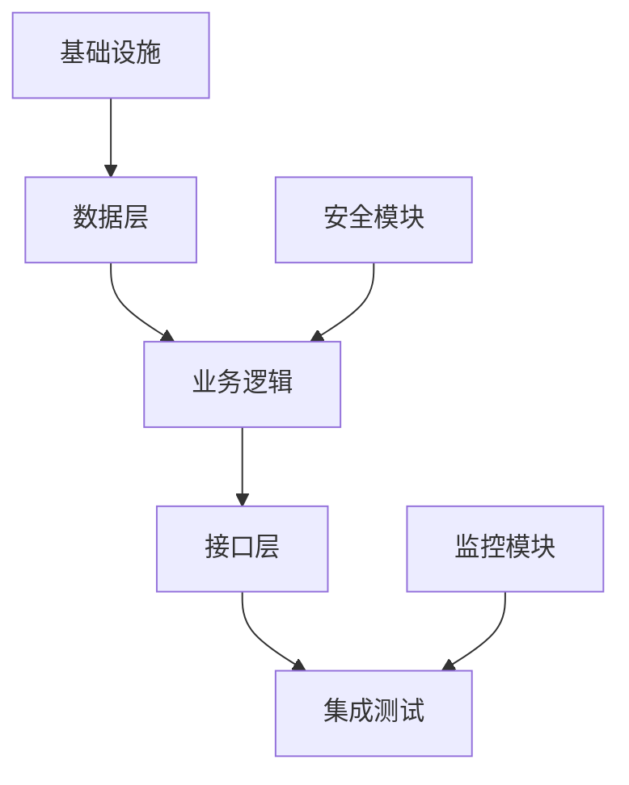

# 任务规划严格控制约束原则 - L3-RIGOROUS

> **级别定位**: L3-RIGOROUS (严格控制级 - 质量优于速度)  
> **🤝 哼将配对**: 与 [CRAFT_L3_TASK_PLANNING.md](../four_stage_crafting/CRAFT_L3_TASK_PLANNING.md) 配对协作
> **核心概念参考**: [CONSTRAINT_CORE_CONCEPTS.md](CONSTRAINT_CORE_CONCEPTS.md)

## 🔗 命名规范权威引用

> - 核心概念定义见 `../agentic_spec/SPEC_ARTIFACT_NAMING_CORE_CONCEPTS.md` (PREFIX, SN, Front Matter, 追溯链字段)
> - L3 级别执行要求见 `../agentic_spec/SPEC_ARTIFACT_NAMING_L3_AUTHORITY.md` (必填 artifacts, 严格模式, 验收标准)

## 🔗 AICodingAgent规范权威引用

> - **ACA宪法**: `../agentic_spec/SPEC_ACA_CORE_PRINCIPLES.md` - 不变量与契约定义 (I1-I4, C1-C3, PDCA)
> - **L3宪章**: `../agentic_spec/SPEC_ACA_L3_CHARTER.md` - L3质量标准 (10-15检查点, 通过率≥95%, 三层追溯)

---

## 🔥 TL;DR - 立即开始

> **目标**：掌握L3-RIGOROUS任务规划约束标准，严格TDD策略质量控制
> 
> **🎯 协作模式路径**：C3-LEAD用户选择L3时执行
> 
> **核心价值**：严格声明式目标制定，质量优于速度，支持审计，为AI自主执行提供完整目标规格

### ⚡ LLM策略要点速查
#### 🚫 严禁行为
- 完成当前任务后绝不自动开始下一个任务（必须停止等待用户指示）
- 绝不在未读requirements/design/implementation三阶段文档情况下执行任务
- 绝不在阶段完成前省略tdd_task_tracking.md和tdd_strategy_order.md的创建
- 不简化严格任务管理要求，避免跳过形式化验证

#### ✅ 必须规划
- **上下文验证**：执行前必须确认已读requirements/design/implementation三文档
- **严格目标规格制定**：设定完整的目标规格和验收标准，支持第三方审计
- **多层验收体系**：多层验收体系，形式化验证流程+质量门禁
- **严格变更控制**：严格变更控制，完整决策记录，支持完整追溯
- **一次一任务**：完成当前任务后必须停止，等待用户指示
- **最终交付物**：阶段完成时必须创建10个核心文档([task_breakdown] + [task_sequence] + [blocker_anticipation] + [ai_context_specification] + [task_coordination_spec] + [acceptance_checkpoints] + [traceability_matrix] + [audit_tracking_spec] + [quality_verification_spec] + [decision_context_spec])
- **严格项目管理**：严格项目管理标准，实时状态+完整审计链+阻塞预警
- **标准话术**："任务规划看起来可以吗？如果可以，我们可以开始TDD实施。"

---

## 术语口径（中文 → English）
- 任务规划（Task Planning）
- 项目管理（Project Management）
- 工作分解结构（Work Breakdown Structure, WBS）
- 里程碑管理（Milestone Management）
- 进度跟踪（Progress Tracking）
- 依赖分析（Dependency Analysis）
- 阻塞预判（Blocker Anticipation）
- 变更控制（Change Control）
- 严格项目管理（Rigorous Project Management）
- 项目审计（Project Audit）
- TDD策略任务规划（TDD Strategy Task Planning）
- 质量门禁（Quality Gates）

---

## 🧪 TDD在任务规划阶段的L3定位

**核心原则**：⭐ TDD的严格策略任务规划阶段 - 完整严格执行规划准备

```
TDD在L3任务规划阶段的职责边界：
✅ 应该做：规划严格TDD策略任务和验证方法
✅ 应该做：制定细粒度任务的策略步骤和验证标准
✅ 应该做：为后续TDD实施提供严格任务清单
✅ 应该做：基于requirements/design/implementation的深度验证规划
✅ 应该做：支持严格项目管理的任务分解和审计要求
✅ 应该做：完整工作分解结构(WBS)和形式化验收流程
❌ 不应做：修改测试计划（属于implementation阶段职责）
❌ 不应做：直接进行代码生产（应通过task_planning指导后续TDD策略）
```

**价值体现**：完成贯通流程的严格文档闭环：基于完备测试计划的TDD策略任务规划

---

## 🎯 L3约束检查重点

### 哼将产出验收标准

> **"哼哈二将"角色分离说明**：在本框架中，CRAFT负责实际内容生产（"哼将"），CONSTRAINT负责质量检查验收（"哈将"）。本文档作为"哈将"，专门验收CRAFT生产的内容质量。

**验收CRAFT生产的任务规划符合L3-RIGOROUS标准：**

- **严格项目管理验证**: 确保任务规划遵循严格项目管理标准
- **严格WBS验证**: 检查使用严格工作分解结构标准
- **严格里程碑管理验证**: 确保里程碑体系遵循严格标准
- **严格变更管理验证**: 验证使用严格变更控制流程标准
- **严格管理验证**: 检查严格项目管理标准
- **上下文验证**: 检查基于requirements/design/implementation三文档
- **节奏控制验证**: 验证一次一任务原则，完成后停止
- **交付物验证**: 检查包含tdd_task_tracking.md和tdd_strategy_order.md
- **审计支持验证**: 验证规划文档支持第三方项目审计
- **质量控制**: 验证严格的质量标准和完整性要求
- **形式化流程**: 检查形式化任务规划流程和严格质量要求
- **目标业务化验证**: 验证Goal标题使用业务术语，包含业务价值说明
- **验收标准分离验证**: 检查验收标准分为"业务视角"和"技术验证"两部分
- **技术术语密度验证**: 验证技术术语密度 ≤ 50%，目标层面业务化
- **L3严格控制验证**: 检查任务规划包含追溯ID和审计记录，支持合规验证，目标清晰

---

## 📋 验收执行协议 ⭐ AI强制执行指南

> **目的**: Task-S6-3必须输出结构化验收报告，包含：验收对象清单、逐项检查结果（✅/❌+具体证据）、通过率统计、失败项详单、验收结论。
>
> **L3特征**: 验收项最多（17项）、标准最严格，需检查审计追溯、文档数量=10。
> 
> **L3数值标准**: 检查点数量=17项，通过率阈值≥95%，追溯深度≥3层（US→DES→SC→GOAL完整汇聚追溯）

### 🔴 强制验收项（L3-RIGOROUS标准）

#### 1. 任务分解合理性验收
- 细粒度任务（0.25-1天），严格WBS结构
- 任务描述完整可审计
- L3额外要求：支持第三方审计、完整决策记录

#### 2. 任务格式合规验收
- 十进制编号 + 复选框 + 四要素（任务目标、需求引用、测试要求、预期输出）
- L3额外要求：追溯ID完整

#### 3. GOAL完整汇聚点验收 ⭐ L3核心特色 (SPEC系统最终汇聚点)
- **GOAL完整汇聚点存在性验收**: 每个GOAL必须作为SPEC系统最终汇聚点，完整承接所有上游制品
- **DES→GOAL传承机制验收**: GOAL继承DES的设计决策和架构约束
- **GOAL完整追溯关系验收**: source_us + related_sc + related_seq + context_refs + related_adr + related_cmp + related_api + audit_log_ref 100%完整性
- **企业级审计元数据验收**: owner+version+timestamp+audit_log_ref完整性
- **完整汇聚验收标准验收**: 需求验证(US)+架构验证(ADR)+组件验证(CMP)+接口验证(API)+测试验证(SC)+审计验证(AUD)
- **GOAL成功条件完整驱动验收**: 关联SC场景+架构符合DES约束+性能达标+100%上游制品覆盖
- **任务序列完整载体驱动验收**: 基于完整上游制品关联的关键路径和并行度分析
- **检查方法**:
  - 步骤1: 确认所有GOAL作为SPEC系统最终汇聚点，完整承接所有上游制品
  - 步骤2: 验证GOAL Front Matter包含所有8个关联字段(source_us + related_sc/seq/adr/cmp/api + context_refs + audit_log_ref)
  - 步骤3: 检查GOAL验收标准覆盖6个维度(需求+架构+组件+接口+测试+审计)
  - 步骤4: 验证GOAL追溯链100%上游制品覆盖度
- **失败案例**:
  - "GOAL缺少related_adr/cmp/api字段" → 无法汇聚设计层制品，破坏完整性
  - "GOAL验收标准不覆盖ADR/CMP/API" → 验收不完整，无法确保架构对齐
  - "GOAL与上游制品关联不一致" → 系统汇聚点失效
  - "缺少GOAL审计元数据" → 任务规划无法支持企业级审计

#### 4. 文档维度完整性验收 ⭐ 原有标准保持
- **L3核心维度标准**: 必须覆盖10个专业维度
  - 维度1: Task Breakdown（任务分解维度）- 必需
  - 维度2: Task Sequence（任务序列维度）- 必需
  - 维度3: Blocker Anticipation（阻塞预判维度）- 必需
  - 维度4: AI Context Specification（AI上下文规格维度）- 必需
  - 维度5: Task Coordination Spec（任务协调规格维度）- 必需
  - 维度6: Acceptance Checkpoints（验收检查点维度）- 必需
  - 维度7: Traceability Matrix（追溯矩阵维度）- 必需（L3追溯）
  - 维度8: Audit Tracking Spec（审计追踪规格维度）- 必需（L3审计）
  - 维度9: Quality Verification Spec（质量验证规格维度）- 必需（L3质量）
  - 维度10: Decision Context Spec（决策上下文规格维度）- 必需（L3决策）
- **维度覆盖验收**: 10个核心维度必须覆盖
- **检查方法**:
  - 步骤1: 确认10个核心维度必须覆盖（每个维度至少有对应文档体现）
  - 步骤2: 确认CRAFT_L3_TASK_PLANNING.md体现维度驱动原则（维度是核心，文件数量是反映）
- **失败案例**:
  - "10个task_breakdown文件" → 缺少其他9个维度覆盖
  - "6个基础维度 + 4个Sequence" → 缺少Traceability/Audit/Quality/Decision维度覆盖

#### 5. 依赖关系清晰验收
- 完整依赖关系分析，支持项目审计
- L3额外要求：关键路径分析、依赖链完整

#### 6. 优先级排序验收
- 多层验收体系，形式化验证流程
- L3额外要求：质量门禁清晰

#### 7. 可执行性验收
- 任务目标明确，验收标准严格
- AI上下文规格完整
- L3额外要求：支持审计要求

#### 8. 声明式目标验收
- Goal描述结果（不是步骤），避免过程式代码

#### 9. 严格变更控制验收 ⭐ L3特有
- 变更控制流程严格
- 决策记录完整
- 支持完整追溯

#### 10. 审计追溯验收 ⭐ L3特有
- 追溯矩阵文档存在且完整
- 审计追踪规格文档存在且完整
- 追溯链完整可审计

#### 11. 质量验证规格验收 ⭐ L3特有
- 质量验证规格文档存在且完整
- 质量门禁清晰

#### 12. WBS结构验收 ⭐ L3特有
- 严格工作分解结构
- 支持项目管理工具

#### 13. 容错控制验收
- 严格变更控制，完整决策记录

#### 14. 节奏控制验收
- 遵循一次一任务原则

#### 15. 上下文验证
- 基于requirements/design/implementation三阶段文档

#### 16. 验收检查点验收 ⭐ L3特有
- 验收检查点文档存在且完整
- 多层验收体系清晰

#### 17. TDD环境准备GOAL验收（⭐ TDD特有需求）
- goal_breakdown.md中存在环境准备GOAL（包含完整Front Matter: id/sn/status/owner/version/source_vs，建立完整追溯体系）
- 声明三个维度需求：测试/开发环境分离、端口配置、.gitignore配置（包含审计追踪和决策记录）
- 验收标准包含完整追溯（环境可运行/端口无冲突/.gitignore覆盖技术栈，配置决策有完整追溯记录，配置变更有完整追踪）
- 任务序列文档中环境GOAL排首位，建立关键路径依赖
- 任务协调规格文档中定义环境配置的严格协调契约
- 验收检查点文档中定义多级验收标准（功能+质量+审计）
- 追溯矩阵文档中建立环境配置的端到端追溯链
- 审计追踪规格文档中定义环境配置的审计追踪机制
- 决策上下文规格文档中记录环境配置的决策理由和上下文

---

### 📊 强制验收报告格式

```markdown
## 📋 CONSTRAINT验收报告 - L3 Task Planning - 第{N}轮

**验收标准**: CONSTRAINT_L3_TASK_PLANNING.md
**验收对象**: spec/task_planning/ 目录（X个文档，共Y行）

### 验收项结果

1. [✅/❌] 任务分解合理性验收
   - 检查结果: [具体证据]

2. [✅/❌] 任务格式合规验收
   - 检查结果: [具体证据]

3. [✅/❌] GOAL测试资产载体验收 ⭐ L3核心特色
   - 检查结果: [具体证据]
   - GOAL载体验收: 基于DES分解 [✅/❌] + DES→GOAL传承 [✅/❌] + GOAL追溯关系 [✅/❌] + 审计元数据 [✅/❌] + 设计驱动验收标准 [✅/❌] + GOAL成功条件 [✅/❌] + 任务序列DES驱动 [✅/❌]
   - 失败示例: "GOAL缺少基于DES的关联，无法建立设计驱动任务分解"

4. [✅/❌] 文档维度完整性验收 ⭐
   - 检查结果: [具体证据]
   - 核心维度验收: Breakdown [✅/❌] + Sequence [✅/❌] + Blocker [✅/❌] + AIContext [✅/❌] + Coordination [✅/❌] + Checkpoints [✅/❌] + Traceability [✅/❌] + Audit [✅/❌] + Quality [✅/❌] + Decision [✅/❌]
   - 失败示例: "10个task_breakdown文件，缺少其他9个维度"

15. [✅/❌] 上下文验证
   - 检查结果: [具体证据]

16. [✅/❌] 验收检查点验收 ⭐ L3特有
   - 检查结果: [具体证据]

17. [✅/❌] TDD环境准备GOAL验收 ⭐
   - 检查结果: [具体证据]
   - 环境GOAL存在性: [✅/❌] goal_breakdown.md中包含环境准备GOAL（完整Front Matter + 完整追溯）
   - 三维度声明: [✅/❌] 测试/开发分离 + 端口配置 + .gitignore（审计追踪+决策记录）
   - 验收标准完整追溯: [✅/❌] 环境可运行/端口无冲突/.gitignore覆盖/配置决策追溯/配置变更追踪
   - 执行顺序: [✅/❌] 任务序列文档中环境GOAL排首位，关键路径依赖
   - 严格协调契约: [✅/❌] 任务协调规格文档中定义环境配置协调
   - 多级验收标准: [✅/❌] 验收检查点文档中定义多级验收（功能+质量+审计）
   - 端到端追溯链: [✅/❌] 追溯矩阵文档中建立环境配置追溯链
   - 审计追踪机制: [✅/❌] 审计追踪规格文档中定义环境配置审计追踪
   - 决策上下文记录: [✅/❌] 决策上下文规格文档中记录环境配置决策理由

### 通过率统计
- 通过项: X/17
- **通过率**: Z%

### 失败项详单（如有）
- 验收项N: 失败原因 + 修复建议

### 验收结论
[✅ 通过率≥95%，继续Task-S6-4] / [❌ 通过率<95%，触发Human-in-the-loop]
```

**关键要求**:
- 每个验收项必须有明确判定（✅/❌）+ 具体证据
- L3特殊要求：GOAL测试资产载体完整性、审计追溯必须验收、文档数量必须=10、任务粒度0.25-1天、支持第三方审计、环境准备GOAL必须包含完整追溯体系（追溯矩阵、审计追踪、决策上下文）
- **通过率标准**: ≥95%通过，继续Task-S6-4；<95%触发Human-in-the-loop

---

## 📋 Scaffold产出质量验收标准

> **验收目标**: 确保task_planning目录下的scaffold文档符合L3-RIGOROUS严格控制标准，实现"哼哈二将"职责分离

### 🔍 任务文档体系质量验收

**要求0_GOAL测试资产载体验收**：⭐ L3核心特色
- [ ] GOAL测试资产载体完整性：每个GOAL必须基于DES测试资产载体分解
- [ ] DES→GOAL传承机制：GOAL继承DES的设计决策、架构约束和验证标准
- [ ] GOAL追溯关系完整性：source_us + related_sc + related_seq + context_refs完整覆盖
- [ ] 企业级审计元数据：owner+version+timestamp+audit_log_ref完整性
- [ ] 设计驱动GOAL验收标准：基于DES的架构验证/组件验证/接口验证/审计验证
- [ ] GOAL成功条件设计驱动：关联SC场景+架构符合DES约束+性能达标
- [ ] 任务序列DES载体驱动：基于DES依赖关系的关键路径和并行度分析

**要求1_文档体系验收**：
- [ ] task_planning/目录结构完整，包含10个专业任务规划文档
- [ ] 文档组织架构体现L3严格控制特征，支持项目审计要求
- [ ] 完整追溯体系理念贯穿始终，建立完整项目管理决策记录体系

**要求2_策略规划验收**：
- [ ] 规划方法论完整，体现规划方法、框架选择、管理工具
- [ ] 执行编排完整，体现执行顺序、并行策略、调度优化
- [ ] 时间管理机制完善，体现进度计划、里程碑设置、时间控制
- [ ] 任务策略决策记录完整，支持项目审计和决策追溯

**要求3_验证跟踪验收**：
- [ ] 进度跟踪机制完整，体现进度监控、跟踪工具、状态管理
- [ ] 里程碑验证体现里程碑检查、验证标准、确认流程

**要求4_质量标准验收**：
- [ ] 交付门禁机制完整，体现交付门禁、质量检查、发布流程
- [ ] 上下文管理体现上下文保持、信息传递、状态同步

### 📊 任务内容质量深度验收

#### 核心维度内容质量验收（10个维度）
- [ ] **文档组织架构质量验收**
  - task_planning/目录包含10个专业任务规划文档，结构完整
  - 目录结构体现完整追溯体系，支持项目审计要求
  - 协作模式体现C3-LEAD特征，用户主导控制明确
  - L3严格控制理念一致表达，项目质量标准严格

- [ ] **目录层级组织质量验收**  
  - 目录层级深度合理(2-4层)，便于项目导航和管理
  - 文件布局规范专业，项目文档命名规范一致
  - 导航方式便于项目追溯，层级关系清晰
  - 层级管理支持项目审计，结构稳定可靠

- [ ] **分类粒度策略质量验收**
  - 任务规划分类逻辑清晰合理，项目模块组织科学
  - 粒度控制适当，既详细又便于项目团队协作
  - 组织方式专业化，符合项目管理最佳实践
  - 支持完整追溯体系，项目决策可追踪

- [ ] **关联复杂度管理质量验收**
  - 任务关联关系明确定义，项目依赖链条清晰
  - 依赖复杂度控制合理，避免过度复杂
  - 交叉引用策略清晰，项目追溯路径明确
  - 影响分析机制完整，任务变更影响可控

- [ ] **内容深度策略质量验收**
  - 任务规划内容详细程度符合L3标准，项目深度充分
  - 充实度标准明确，项目内容质量可衡量
  - 深度把握专业，任务规划和执行平衡适当
  - 有效服务TDD实施阶段输入，项目衔接顺畅

- [ ] **形式化程度质量验收**
  - 项目管理模板规范度高，任务格式严格标准
  - 任务规划结构严格性强，项目模式使用一致
  - 执行技巧实用性强，项目可操作性好
  - 认知要点集成完整，项目理解门槛适中

#### 任务规划专项内容质量验收（9个专项）
- [ ] **规划方法论质量验收**
  - 规划方法论设计清晰，框架选择合理适用
  - 管理工具选择科学，项目管理方法论完整
  - 规划流程设计专业，项目规划标准化程度高

- [ ] **执行编排质量验收**  
  - 执行顺序安排策略合理，并行策略设计明确
  - 调度优化方法设计有效，资源利用率高
  - 任务并发控制机制完整，执行效率保证

- [ ] **时间管理质量验收**
  - 进度计划制定详细，里程碑设置策略合理
  - 时间控制机制设计完整，进度阻塞管理到位
  - 时间缓冲策略明确，延期处理机制完整

- [ ] **进度跟踪质量验收**
  - 进度监控机制设计完整，跟踪工具选择适当
  - 状态管理方法设计有效，实时更新机制完整
  - 进度报告体系完善，项目可视化程度高

- [ ] **里程碑验证质量验收**
  - 里程碑检查标准设计明确，验证标准清晰可执行
  - 确认流程设计完整，质量门禁机制严格
  - 里程碑输出物要求明确，验收标准具体

- [ ] `<completion-criteria>` 内容验收
  - 完成定义清晰
  - 检查标准明确
  - 验收条件可判定

- [ ] `<delivery-gates>` 内容验收
  - 交付门禁标准明确
  - 质量检查机制完整
  - 发布流程清晰

- [ ] `<context-management>` 内容验收
  - 上下文保持机制完整
  - 信息传递方法有效
  - 状态同步机制清晰

- [ ] `<handover-criteria>` 内容验收
  - 移交清单完整
  - 检查标准明确
  - 交接要求清晰可执行

### 🔄 Level间一致性质量验收
- [ ] L1/L2/L3任务规划在技术逻辑上保持一致
- [ ] 不同Level的技术复杂度符合各自特征(L3最严格)
- [ ] Level间切换时任务规划范围逻辑一致
- [ ] 没有Level间的技术方案冲突

### ⚡ 任务规划质量快速检查清单
- [ ] GOAL测试资产载体完整性作为L3核心特色全面覆盖
- [ ] 4个核心任务规划类别全部覆盖且内容完整
- [ ] 15个任务规划专项全部实现且内容充实
- [ ] 任务规划内容体现L3严格控制理念
- [ ] 任务规划结构支持Level间无缝切换
- [ ] 所有任务规划内容有效服务TDD实施阶段输入

---

## 📋 L3质量门禁标准

### ✅ 门1 · 就绪门 [G1‑READY|LM3‑STRICT]
按权威文件 `CONSTRAINT_CORE_CONCEPTS.md` 中 LM3‑STRICT 原则逐条自检：
- [ ] Layer‑first, Contract‑first（分层优先、契约优先）：任务规划分层与验收契约先明确
- [ ] Change control / Review（变更控制/评审关口）：任务变更控制和技术评审机制
- [ ] Threat modeling & Observability（威胁建模/可观测性）：阻塞管理和项目可观测性规划
- [ ] Feature → Architecture（SOLID）组织：基于SOLID原则的任务规划组织
- [ ] Traceability matrix（严格追溯矩阵）：建立严格任务规划 ↔ 组件设计 ↔ 实施的追溯关系(US→DES→SC→SEQ→BLK)
- [ ] **L3审计级Front Matter完整性**: 所有SEQ/BLK包含id, sn, status, owner, version字段
- [ ] 系统化分层生成：按技术层次有序组织任务规划内容
- [ ] 完整质量控制：AI+Human协作确保严格任务规划质量标准

> 提示：如任务规划资产不位于默认 `task_planning/` 目录，请在追溯矩阵或交付目录说明中注明映射，确保门禁可准确定位到 `tdd_task_tracking.md` 与 `tdd_strategy_order.md` 等强制文件。

### 📋 门2 · 质量门 [G2-QUAL]
L3核心质量断言（11项严格检查）：
- [ ] **规划完整性**: 覆盖端到端任务体系、阻塞/质量/可扩展性全面考虑
- [ ] **任务颗粒度严格性**: 细粒度任务(2-8小时)，完整WBS+形式化验收
- [ ] **可追溯性**: 任务规划 ↔ 需求 ↔ 实施建立完整追溯关系线索
- [ ] **SEQ格式完整性**: 每个SEQ包含Front Matter (id: SEQ-<SN>-NNN, sn, status, owner, version, related_sc/related_cmp至少1个)
- [ ] **BLK格式完整性**: 每个BLK包含Front Matter (id: BLK-<SN>-NNN, sn, status, owner, version, severity, impact, mitigation, related_seq)
- [ ] **追溯链完整性**: SEQ通过related_sc/related_cmp建立横向追溯，BLK通过related_seq指向SEQ，建立清晰追溯链
- [ ] **任务连贯性**: 任务序列逻辑严格，支持完整增量构建和持续验证
- [ ] **明确性**: 任务规划严格、无歧义，TDD流程决策路径清晰且可判定
- [ ] **变更控制性**: 完整变更控制策略，严格决策记录和审计支持
- [ ] **阻塞/合规**: 识别项目阻塞要求、质量保护、合规约束的任务实现
- [ ] **可运维/可观察**: 记录监控任务、状态验证、运维接口的项目方案
- [ ] **任务决策完整性**: 规划决策记录完整，任务选型有深度调研和阻塞评估
- [ ] **架构一致性**: 多层任务架构视图一致，任务边界清晰，验收契约完整
- [ ] **边界合规性**: 无代码生产内容，保持任务规划职责边界
- [ ] **GOAL清单完整性**: `goal_breakdown.md` 存在，所有 GOAL front matter 含 `id/sn/status/owner/version/source_us/related_sc/related_seq/context_refs`，并与 SEQ 追溯一致
- [ ] **GOAL引用闭环**: 所有有效的 `SC` 与 `SEQ` 至少出现在一个 GOAL 的 `related_sc` / `related_seq` 字段中，确保执行产物无孤立节点
- [ ] **🎯 TDD环境准备GOAL验收**:
  - [ ] goal_breakdown.md中存在环境准备GOAL（包含完整Front Matter: id/sn/status/owner/version/source_vs，建立完整追溯体系）
  - [ ] 声明三个维度需求：测试/开发环境分离、端口配置、.gitignore配置（包含审计追踪和决策记录）
  - [ ] 验收标准包含完整追溯（环境可运行/端口无冲突/.gitignore覆盖技术栈，配置决策有完整追溯记录，配置变更有完整追踪）
  - [ ] 任务序列文档中环境GOAL排首位，建立关键路径依赖
  - [ ] 任务协调规格文档中定义环境配置的严格协调契约
  - [ ] 验收检查点文档中定义多级验收标准（功能+质量+审计）
  - [ ] 追溯矩阵文档中建立环境配置的端到端追溯链
  - [ ] 审计追踪规格文档中定义环境配置的审计追踪机制
  - [ ] 决策上下文规格文档中记录环境配置的决策理由和上下文
- [ ] **📋 LLM质量控制执行验证**: 验收CRAFT是否正确执行质量控制指令
  - [ ] **文件范围合规性**: 确认质量控制仅应用于spec/目录下非_前缀的MD文件（排除_开头的目录和文件）
  - [ ] **长度控制执行验证**: 内容是否按[L1:400-500行|L2:500-600行|L3:600-800行]限制生产，超出是否提供拆分建议
  - [ ] **补丁保护执行验证**: 修改后是否进行了[系统性|逻辑性|一致性]完整性检查，保护既有内容质量
  - [ ] **质量预防执行验证**: 是否执行了信息密度监控、结构清晰保持、术语统一验证等预防性措施
  - [ ] **阶段特异执行验证**: 是否完成了该阶段的特殊质量要求检查[需求逻辑链|架构连贯|TDD流程|任务分解]
  - [ ] **人机协作触发验证**: 发现问题时是否正确触发"立即停止→Human-in-the-loop→建议审查整理修复"机制
- [ ] **受众适配性**: Goal用业务语言，执行细节可用技术语言
- [ ] **技术术语密度**: 技术术语密度 ≤ 50%
- [ ] **目标业务化**: Goal标题包含业务价值说明
- [ ] **验收标准分离**: 分为"业务视角"和"技术验证"
- [ ] **任务序列业务化**: 任务序列标题业务友好，包含业务目标/价值
- [ ] **L3审计追溯**: 任务规划包含追溯ID和审计记录，支持合规验证
- [ ] **owner/version字段覆盖率**: 所有SEQ和BLK的owner和version字段100%完整
- [ ] **审计就绪性**: 支持第三方审计，任务序列追溯链条清晰，Front Matter完整
- [ ] **批准确认性**: 收到用户明确正面回应

---

## 📁 文件组织验收标准

### 目录结构检查（spec/task_planning/）
- **位置验收**: 默认`spec/task_planning/`或等效目录
- **GOAL清单**: `goal_breakdown.md` 为必备文件，存放于 task_planning 根目录
- **主线类目**: 严格任务规划如`[严格任务规划文件名].md`（多层任务架构）
- **必要分类**: 任务架构如`[任务架构文件名].md`，任务契约如`[任务契约文件名].md`，WBS分解如`[WBS分解文件名].md`，质量门禁如`[质量门禁文件名].md`，阻塞预判如`[阻塞预判文件名].md`，变更控制如`[变更控制文件名].md`
- **技术决策**: 任务决策记录如`[任务决策记录文件名].md`，规划评估如`[规划评估文件名].md`，阻塞分析如`[阻塞分析文件名].md`
- **追溯文档**: 任务追溯矩阵如`[任务追溯矩阵文件名].md`
- **交付物**: tdd_task_tracking.md在根目录，tdd_strategy_order.md在task_planning目录
- **命名规范**: 文件名采用lower_snake_case + `.md`
- **内容边界**: 严禁出现代码生产/具体TDD执行等非规划产物

---

## 🎯 边界约束原则

### ❌ 严禁行为
- **无上下文规划**: 绝不允许在没有前三阶段文档的情况下开始任务规划
- **浅层任务分析**: 避免基于不充分分析的任务规划制定
- **自动推进**: 完成当前任务后自动开始下一个任务
- **代码生产**: 不进行任何实际代码生产，专注任务规划

### ✅ 专注职责
- **严格任务规划**: 基于前三阶段的严格任务策略规划，支持严格质量要求
- **深度项目评估**: 严格项目评估，完整阻塞分析，长期维护性优先
- **契约优先设计**: 完整任务契约，支持严格的项目集成

---

## 🔧 严格任务规划指导

### 严格任务决策树
1. **性能与扩展任务评估** → 确定任务架构模式(根据负载和扩展需求)
2. **阻塞合规任务分析** → 设计阻塞管理策略(基于威胁模型和合规框架)
3. **集成与契约任务** → 设计任务接口规范(根据集成复杂度和性能要求)
4. **可观测性任务** → 制定监控任务方案(基于项目可观测性要求)

### 严格任务策略矩阵
- **金融系统**: 严格任务分层 + 合规性任务 + 审计追溯任务
- **高并发系统**: 性能任务策略 + 压力测试任务 + 并发安全任务
- **AI/ML系统**: 模型任务策略 + 数据管道任务 + A/B测试管理任务
- **企业集成**: 契约任务策略 + API任务 + 服务治理任务

### 阻塞评估维度
- **任务债务**: 评估任务遗漏成本与长期维护
- **合规要求**: 考虑行业标准、数据保护、审计需求任务
- **可观测性**: 监控、日志、追踪、告警的完整任务设计

---

## 🔒 质量门禁原则

### 📋 审批流程要求
```
任务规划完成后的强制流程：
1. 创建完整task_planning/目录结构，包含严格的任务规划体系，支持项目审计
2. 基于前三阶段完成深度任务分解、多方案对比和阻塞评估
3. 创建强制交付物：tdd_task_tracking.md(根目录) + tdd_strategy_order.md(task_planning目录)
4. 必须询问："任务规划看起来可以吗？如果可以，我们可以开始TDD实施。"
5. 遵循一次一任务原则，完成后停止等待用户指示
6. 如用户要求修改，必须调整后重新规划
```

### 🔄 反馈-修订循环机制
- **严格流程控制**: 遵循严格任务规划流程，质量优于速度
- **持续修订**: 必须根据用户反馈持续完善规划文档
- **节奏控制**: 严格遵循一次一任务，不自动推进，支持项目审计要求

---

## 📤 输出验收标准

### L3交付物验收
- **结构验收**: 完整`task_planning/`目录结构，支持项目审计，覆盖任务分解（融合WBS）、任务序列（融合关键路径）、阻塞预判、AI上下文规格、任务协调规格、验收检查点、追溯矩阵、审计追踪规格、质量验证规格、决策上下文规格十个核心维度，建立完整追溯体系和多层验证机制
- **强制交付物**: tdd_task_tracking.md在根目录，tdd_strategy_order.md在task_planning目录
- **内容验收**: 500-700行范围，确保严格完整性和详尽性，支持项目审计要求
- **对接验收**: 确保输出能无缝成为后续TDD实施严格输入，支持完整技术追溯
- **质量验收**: 严格控制，完整技术追溯导向，支持第三方项目审计

### 节奏控制验收
必须遵循一次一任务原则，完成当前任务后停止等待用户指示

### 严格选择策略验收
根据项目类型和技术要求进行任务规划制定：
- 关键业务系统：严格任务分层 + 完整项目设计
- 高并发系统：严格性能任务 + 可扩展任务架构
- 金融系统：严格合规任务 + 审计支持
- 医疗系统：HIPAA严格任务 + 隐私保护任务设计

### 严格依赖关系检查清单
- [ ] 完整任务规划交付物是否能无缝对接后续TDD实施的严格输入要求？
- [ ] 严格任务策略是否为后续TDD执行提供完整充分信息？
- [ ] 完整任务方案是否完全覆盖前三阶段中所需考虑的技术因素？
- [ ] 严格任务契约是否为项目集成提供完整技术边界条件？
- [ ] 整体任务策略是否形成完整的技术决策闭环和追溯体系？
- [ ] 任务决策记录是否为技术实施提供完整依据？
- [ ] 阻塞预判设计是否为阻塞控制提供完整指导？
- [ ] 可观测性任务是否为运维监控提供完整架构支持？

---

## 🚨 L3常见违规行为

### ❌ 边界违规
- 在规划中生产实际代码或任务实施，违反严格边界
- 进行任务驱动开发实际执行
- 跳过深度任务分析直接选择规划方案
- 在规划阶段实施任务而非仅做规划
- 自动推进到下一个任务而不停止

### ❌ 格式违规
- 任务策略结构不完整，缺少任务决策记录等关键元素
- 任务规划不严格，缺少多层任务架构或分层不清晰
- 任务契约不完整或缺乏严格规范
- 任务决策缺乏深度调研和阻塞评估记录
- 输出格式不符合后续TDD实施阶段严格输入要求

### ❌ 质量违规
- 独立技术思维，不考虑与后续TDD实施的严格对接和完整追溯
- 未等待用户严格批准就开始TDD实施讨论
- 收到否定反馈后不进行完整修改
- 允许质量问题向后传递到后续TDD实施阶段
- 任务决策记录缺失，任务架构变更和决策缺乏完整记录

**修正策略**: 立即回到L3严格原则，重新执行严格流程，确保严格依赖关系和完整技术追溯体系。

---

## 🤖 AI协作策略指导

#### 📁 文件操作约束
- **文件操作**: AI必须创建完整`task_planning/`目录结构，支持项目审计
- **初始版本生成**：基于前三阶段文档生成严格任务规划方案，深度技术调研
- **完整性保证**：包含任务规划概述、任务架构、任务契约、质量门禁、阻塞预判、变更控制、任务决策记录等
- **版本管理**：每次修改后保存完整版本，确保技术决策可追溯性和审计支持
- **强制交付物**: 必须创建tdd_task_tracking.md(根目录)和tdd_strategy_order.md(task_planning目录)
- **严禁代码生产**: 本阶段专注严格任务规划，严禁进行任何代码开发
- **生产长度控制**: 500-700行范围，确保严格完整性和详尽性，支持项目审计要求

#### 🎯 策略节奏精确控制
- **系统化任务原则**：按技术层次有序组织任务规划内容，生成严格完整规划
- **完整质量控制**：AI+Human协作确保严格任务规划质量标准，遵循严格流程
- **全面技术考虑**：主动考虑所有任务要求、阻塞约束、质量指标和可扩展性
- **任务决策记录维护**：维护完整的任务决策和任务架构变更记录，支持完整审计

#### 💬 交互标准化协议
- **标准询问话术**：必须使用固定话术"任务规划看起来可以吗？如果可以，我们可以开始TDD实施。"
- **节奏控制话术**：完成任务后必须停止，等待用户指示下一步
- **上下文确认**：开始前确认已读requirements/design/implementation三文档
- **技术审计记录维护**：维护完整的交互记录，支持项目审计和合规检查

---

## 📄 L3格式模板详解

### 🔥 L3-RIGOROUS格式模板
```markdown
# TDD任务规划（L3严格版）

## TDD策略概述
[详细TDD策略任务规划分析，包含策略哲学和质量目标]

## 严格控制任务跟踪系统
### 完整任务状态矩阵
| 任务ID | 任务类别 | 具体任务 | 责任人 | 状态 | 开始时间 | 完成时间 | TDD策略要点 | 验证标准 | 阻塞等级 | 备注 |
|--------|----------|----------|--------|------|----------|----------|-------------|----------|----------|------|
| T001 | [功能域] | [具体任务] | [负责人] | 待开始 | - | - | [详细TDD策略] | [形式化验证] | 高/中/低 | [说明] |

### 多维度策略规划分析
#### 技术依赖关系图


#### 业务价值排序矩阵
| 任务 | 业务价值 | 技术复杂度 | 阻塞等级 | 优先级得分 |
|------|----------|------------|----------|------------|
| [任务A] | 高 | 中 | 低 | 85 |
| [任务B] | 中 | 高 | 高 | 60 |

## 严格控制验证体系
### 四层验证跟踪
1. **任务级验证**: 每个任务的TDD策略完成度
2. **需求级验证**: 原始需求的完整追溯
3. **设计级验证**: 技术架构的一致性
4. **集成级验证**: 系统整体的协调性

### 质量门禁控制
- **代码质量**: 测试覆盖率 > 90%
- **性能基准**: 响应时间 < 100ms
- **安全标准**: 零高危漏洞

## 任务策略决策记录
[Task Strategy Decision Records]
- 重要任务选型及其理由
- 权衡分析和阻塞评估
- 决策上下文和约束条件
- 任务决策的长期影响分析

## 强制交付物说明
- tdd_task_tracking.md: 项目根目录TDD实施进度总跟踪
- tdd_strategy_order.md: task_planning目录TDD策略顺序规划
```

### 📊 严格结构要求
- **策略部分**：详细TDD策略任务规划概述和明确技术目标分析，包含技术价值
- **架构部分**：多层任务架构 + 任务类型矩阵 + 详细策略流程 + 性能扩展性
- **验证部分**：详细验证规范 + 安全验证 + 版本管理 + 兼容性策略
- **控制部分**：分层策略 + 详细流程 + 监控告警 + 灾难恢复
- **决策记录**：完整任务决策记录，支持项目审计

---

*"L3约束以严格任务规划控制为核心，通过完整技术追溯和严格质量控制，确保为后续TDD实施提供高质量任务策略基础。"*
